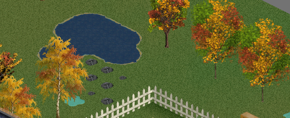
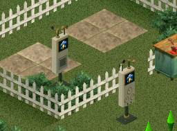
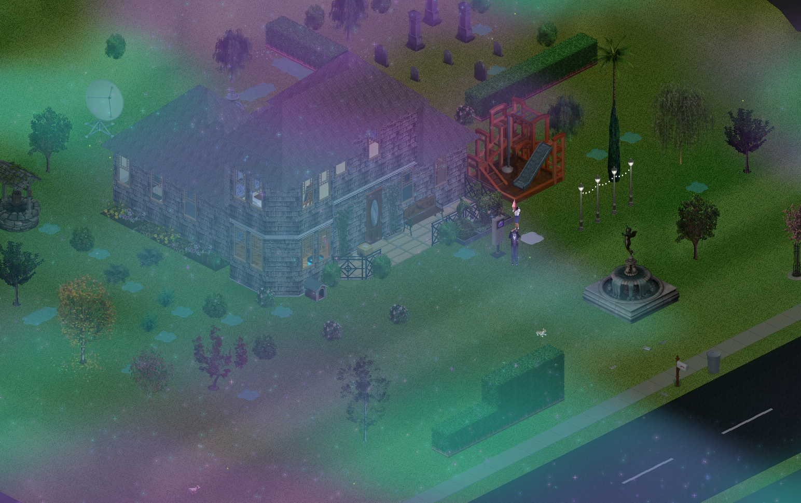
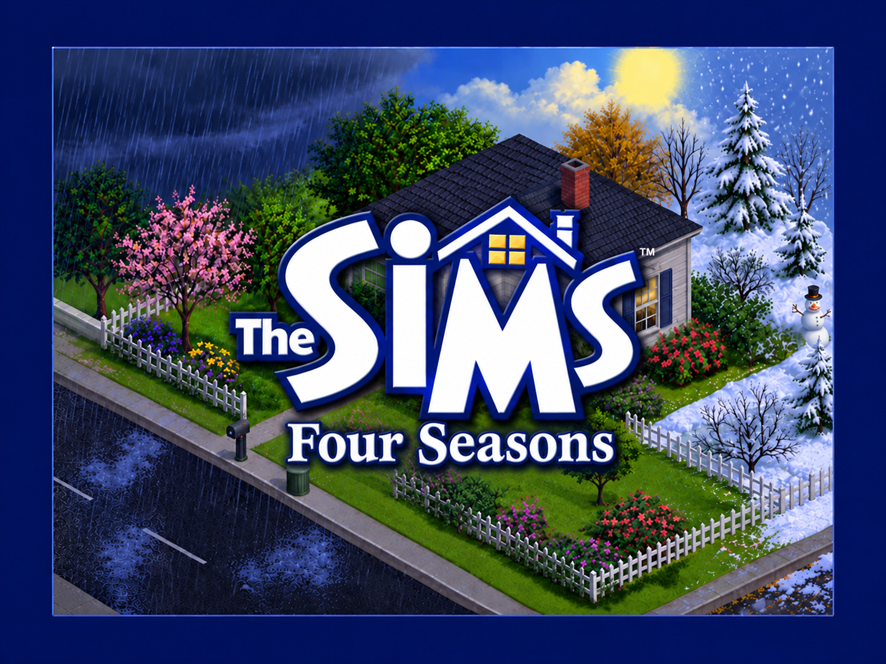
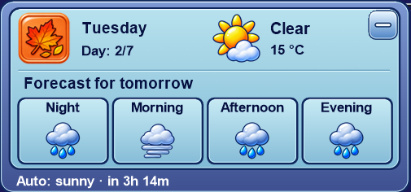

# Die Sims Vier Jahreszeiten

**Erste öffentliche Beta · 1.0.0-beta.1**

<!-- quick-links -->
  
<!-- /quick-links -->

[English](../README.md) · [Polski](README.pl-PL.md) · [Dansk](README.da-DK.md) · **Deutsch** · [Español](README.es-ES.md) · [Suomi](README.fi-FI.md) · [Français](README.fr-FR.md) · [Italiano](README.it-IT.md) · [日本語](README.ja-JP.md) · [한국어](README.ko-KR.md) · [Norsk bokmål](README.nb-NO.md) · [Nederlands](README.nl-NL.md) · [Português (Brasil)](README.pt-BR.md) · [Svenska](README.sv-SE.md) · [ไทย](README.th-TH.md) · [简体中文](README.zh-CN.md) · [繁體中文](README.zh-TW.md)

Die Fan-Erweiterung Vier Jahreszeiten gibt jedem Haushalt in The Sims Legacy Collection einen eigenen Jahreszeitenkalender und eine örtliche Wettervorhersage. Am Wochenende haben die Sims frei von Schule und Arbeit. Regen bewässert den Garten, durchnässte Sims können sich erkälten und bei genügend Schnee kann die Familie einen Schneemann bauen. Mit zwei neuen Zaubersprüchen können Sims magisches Wetter auf ihr Grundstück holen.

*Ein Wintergrundstück mit verschneiten Dächern und Pflanzen*

[Bilder aus dem Spiel](#gallery) · [Vollständige Galerie (ZIP, 11 Bilder)](https://github.com/TS1-Mod-Studio/The-Sims-1-Four-Seasons/releases/download/v1.0.0-beta.1/The-Sims-1-Four-Seasons-Screenshots.zip)

## Das Wetter auf deinem Grundstück

### Wochentage, Jahreszeiten und die Vorhersage für morgen

- Die Woche läuft von Montag bis Sonntag. Samstags und sonntags haben Kinder schulfrei und berufstätige Sims haben frei. Schulbus und Fahrgemeinschaft bleiben aus. Das Wochenende zählt nicht als versäumter Arbeitstag. Auch Nachtschichten werden berücksichtigt.
- Jedes Wohngrundstück hat seinen eigenen Kalender. Frühling, Sommer, Herbst und Winter dauern standardmäßig jeweils sieben Sim-Tage. Für ein längeres Jahr kannst du 14 oder 28 Tage pro Jahreszeit wählen. Im Kalender unter **Ctrl+Alt+R** kannst du die Jahreszeit, den Tag innerhalb der Jahreszeit, den Wochentag und die Uhrzeit einstellen. Wetter und Kalender werden mit dem Haushalt gespeichert.
- Die einklappbare Wetteranzeige zeigt den Wochentag, die Jahreszeit, die Temperatur und das aktuelle Wetter. Die Vorhersage für morgen ist in Nacht, Morgen, Nachmittag und Abend unterteilt. Bei automatischem Wetter können Sims den Wetterbericht auch auf unterstützten Fernsehern anschauen.
- Auf normalen Gemeinschaftsgrundstücken gelten für deine Familie das Wetter und der Stand der Jahreszeit von zu Hause. Die Urlaubsinsel hat eigene Klimazonen. In den Bergen ist Winter, im Wald Frühling und am Strand Sommer. Der Kalender zu Hause läuft erst nach der Rückkehr weiter.

### Wetter im Garten und im Haus

- Regen, Gewitter, Hagel, Schnee, Schneestürme und Nebel können von selbst aufziehen. Nach Regen kann sich Nebel bilden. Wind weht Regen und Herbstlaub über das Grundstück. Auf Blitze folgt Donner, Wasser läuft von den Dächern, und gewöhnlicher Regen kann draußen sogar einen durch Blitzschlag ausgelösten Brand löschen.
- Regen bewässert Pflanzen unter freiem Himmel. Starker Hagel kann Zierpflanzen im Freien beschädigen. Nachts erscheinen Glühwürmchen in der Nähe von Büschen und Blumen, vor allem im Sommer. Im Herbst färbt sich das Laub. Im Winter bedeckt Schnee den Rasen, Dächer, Straßen, Zäune, Pflanzen, Gegenstände im Freien und Grabsteine. Bei wärmerem Wetter schmilzt er allmählich.
- Sims, Katzen und Hunde werden draußen nass und trocknen unter einem Dach schneller. Sie können Schutz suchen oder eine kleine Pfütze hinterlassen, die sich aufwischen lässt. Bleibt ein Sim lange durchnässt, kann er krank werden, husten und niesen. Im Trockenen erholt er sich. Kinder können draußen von sich aus in Pfützen planschen. Auf deine Anweisung tun das auch Erwachsene.
- Bei Minusgraden drehen sich Sims draußen einmal um und schlüpfen in ihre Winterkleidung. Drinnen ziehen sie sich wieder um. Sie tragen ihr gekauftes Winteroutfit. Wer noch keines hat, bekommt ein zufällig ausgewähltes Outfit und trägt es auch bei späteren Ausflügen. Kaufe für **1 §** einen Bauplatz für einen Schneemann und platziere ihn im Freien. Ab **60 %** Schneebedeckung können Sims dort einen Schneemann bauen, auch auf Gemeinschafts- und Urlaubsgrundstücken. Dort wachsen Wildblumen, solange die Pflanzen schneefrei sind. Werden die Pflanzen eingeschneit, verwandeln sich die Blumen in einen Schneehaufen.

### Zwei neue Zauber im Zauberbuch

Ein erwachsener Sim mit Zauberstab kann beide Rezepte am Zauberstabladegerät zubereiten. Verwende von jeder Zutat ein Exemplar. Jede Zubereitung ergibt **drei Ladungen**. Wähle am Ladegerät **Zauber wirken…**. Gelingt der Zauber, hält das magische Wetter **drei Sim-Stunden** an, auch auf einem Grundstück ohne Wetterstation.

- Für **Nebel der Verzauberung** brauchst du Koboldstaub, Drachentränen und Giftpilze. Gartenzwerge und Vogelscheuchen können lebendig werden, Gartenflamingos verwandeln sich mitunter in Tänzer, Schach- und Damespiele spielen von allein, und Kühlschranktüren bewegen sich von selbst. Es können Giftpilze zum Sammeln sprießen. An geeigneten Gräbern zeigen sich zwischen **22 und 6 Uhr** häufiger Geister. Solange der Nebel anhält, können unterstützte Gegenstände die Bedürfnisse Energie, Spaß, Hygiene, Blase und Hunger **50 % schneller** erfüllen. An Lernobjekten bauen Sims ihre Fähigkeiten **doppelt so schnell** aus. Du kannst die Häufigkeit magischer Ereignisse einstellen und die einzelnen Boni ein- und ausschalten.
- Für **Regen der Verzauberung** brauchst du Koboldstaub, Drachentränen und Clown-Konfetti. Farbige Tropfen hinterlassen animierte Pfützen in Regenbogenfarben. Der Regen wässert und stärkt lebende Pflanzen unter freiem Himmel und kann angebautes Gemüse reifen lassen. Auf freien Rasenflächen können bis zu **sieben** der ursprünglichen Fähigkeitskristalle aus *Hokus Pokus* wachsen. Sie bleiben nach dem Schauer erhalten und können Sims ihre Fähigkeiten vermitteln, sobald sie ausgewachsen sind.
- Magisches Wetter kann auch von selbst auftreten. In Magic Town ist magischer Nebel häufiger, besonders nachts. Außerhalb des Winters ist dort auch magischer Regen wahrscheinlicher.

### Wetterstation, Einstellungen und Ton

- **Die Wetterstation verdienen.** Die Station gibt es ausschließlich als einmalige Belohnung für den Haushalt. Du erhältst sie, sobald ein einzelner Sim **10 Punkte in Logik und 10 in Mechanik** erreicht. Das Spiel stellt sie auf ein freies Feld unter freiem Himmel auf dem Wohngrundstück und meldet den Erfolg. Ist der Hof vollgestellt, schaffe draußen etwas Platz. Bei einem Umzug folgt die Station der Familie.
- **Die Station bedienen.** Wähle einen Sim mit mindestens **7 Punkten in Logik und 6 in Mechanik** und klicke auf die Station. Du kannst die Stärke von Regen, Gewittern, Hagel, Schneefall und Schneestürmen sowie die Dichte des Nebels einstellen. Magischer Regen und magischer Nebel haben eigene Menüpunkte. Du kannst auch das aktuelle Wetterphänomen beenden, die Jahreszeit wechseln oder einen Wochentag wählen. Ein Sim mit geringeren Fähigkeiten kann sich die Voraussetzungen anzeigen lassen. Die automatische Wettersteuerung läuft, sobald du das Grundstück lädst.
- Im Wetterfenster lassen sich Durchnässung, Regenreaktionen, Krankheit, Winterkleidung, Schutzsuche bei Hagel, Regenpfützen, Pfützen beim Trocknen, Planschen, Schneemänner, das Löschen von Bränden durch Regen und Nebel nach Regen einzeln ein- oder ausschalten. Du kannst auch Effekte, Ton und Animationsleistung einstellen. Das Wetter folgt Spielpause, Spielgeschwindigkeit, Zoom und Kamera.
- Der Mod enthält lokalisierte Ladebildschirme und das eigens komponierte Ladebildschirmstück *Pocztówka z doliny*.

## Download und Installation

Du brauchst eine installierte Vollversion von The Sims Legacy Collection in Version **1.10.0** oder **1.10.7**, Windows mit 64 Bit und die [Microsoft .NET Desktop Runtime 10 (x64)](https://dotnet.microsoft.com/download/dotnet/10.0). Plane mehrere GB freien Speicherplatz sowie Platz für eine Kopie deiner Spielstände ein.

1. Öffne auf der GitHub-Projektseite [Releases](https://github.com/TS1-Mod-Studio/The-Sims-1-Four-Seasons/releases/tag/v1.0.0-beta.1), wähle **1.0.0-beta.1** und lade unter **Assets** das Archiv `The-Sims-1-Four-Seasons-1.0.0-beta.1.zip` herunter.
2. Speichere dein Spiel und schließe das Spiel und das Wetterprogramm. Entpacke das gesamte ZIP-Archiv in einen neuen Ordner. `data` und `Setup.exe` müssen im selben Ordner liegen.
3. Starte `Setup.exe` und wähle den Spielordner mit `sims.exe` aus. Klicke zuerst auf **Kompatibilität prüfen** und anschließend auf **Installieren**. Das Programm prüft und sichert die Dateien und wendet die Patches auf deine Spieldaten an. Bei einem Konflikt mit einer erforderlichen Datei bricht es die Installation ab.
4. Warte, bis die Installation abgeschlossen ist. Starte das Spiel künftig über die Desktopverknüpfung **The Sims Cztery Pory Roku** oder über `Launch-weather.cmd` im Installationsordner des Wetterprogramms. So starten Spiel, Wetter und Spielstandverarbeitung gemeinsam.

Überlasse das Ändern der Spieldateien dem Installationsprogramm. Es prüft vor und nach jedem Patch die Prüfsummen und lässt `sims.exe` unverändert. Optionale Objekte werden nur angepasst, wenn eine unterstützte Version davon bereits installiert ist.

## Das Wetterprogramm für Windows

Die Desktopverknüpfung startet das Wetterprogramm zusammen mit dem Spiel. Drücke während des Spiels `Ctrl+Alt+R` oder doppelklicke auf das Wettersymbol im Infobereich von Windows neben der Uhr. Diese Einstellungen stehen dir bei jedem Haushalt zur Verfügung, auch wenn noch kein Sim die Station verdient hat.

Wähle eine Voreinstellung für den Niederschlag oder passe einzelne Werte wie die Zahl der Regentropfen, die Größe der Schneeflocken und die Lautstärke des Sturmwinds an. Wind und Bewölkung lassen sich für das Grundstück einstellen und wieder auf Automatik schalten. Im Kalender kannst du die Länge der Jahreszeiten, den Tag und die Uhrzeit auf dem aktiven Wohngrundstück ändern. Die Spieloptionen bestimmen, wie sich das Wetter auf Sims und Haustiere auswirkt. Die Wettereffekte lassen sich auf 30 Bilder pro Sekunde begrenzen.

Die Objektmenüs verwenden die Spielsprache. Das Wetterprogramm übernimmt sie standardmäßig. Wählst du für das Programm eine andere Sprache, gilt sie ab dem nächsten Start.

## Sicherung, Aktualisierung und Deinstallation

Das Installationsprogramm sichert betroffene Dateien, Spielstände und Wetterdaten. Bewahre `backups` und `install-state.json` im Programmordner unter `%LOCALAPPDATA%\TS1CzteryPoryRoku` auf. Wetterdaten einzelner Grundstücke liegen auch unter `%LOCALAPPDATA%\TS1RainOverlay`. Gesicherte Spielstände kannst du bei geschlossenem Spiel manuell wiederherstellen. Lass den Spiel- und den Programmordner an ihrem ursprünglichen Ort.

Die Sicherung umfasst `Electronic Arts\The Sims 25` im Windows-Ordner für gespeicherte Spiele sowie vorhandene `UserData`, `UserData2`-Ordner im Spielverzeichnis. Jede Sicherung erhält einen eigenen Ordner. In `save-backup.json` stehen die ursprünglichen Pfade und Prüfsummen, mit denen du die gewünschten Dateien für eine manuelle Wiederherstellung findest.

Für ein Update schließt du Spiel und Wetterprogramm, entpackst das neue ZIP in einen separaten Ordner und wählst im neuen Installationsprogramm denselben Spielordner. Zum Entfernen schließt du beide Programme und wählst in der aufbewahrten `Setup.exe` die Option **Optionen → Deinstallieren**. Die ursprünglichen Dateien werden wiederhergestellt, Spielstände und Sicherungen bleiben erhalten. Möchtest du die Mod-Objekte später wieder nutzen, behalte eine Kopie des Grundstücks aus der Zeit vor dem Spielen ohne Mod.

Wurde die Installation unterbrochen, wähle **Optionen → Änderungen zurücksetzen**. Meldet die Wiederherstellung eine veränderte Datei, bewahre die Meldung und die Sicherungen auf. Verweigert Windows den Schreibzugriff, starte `Setup.exe` mit Administratorrechten unter demselben Windows-Konto.

<!-- gallery -->

## Bilder aus dem Spiel

| Herbstlaub | Wetterstation |
| --- | --- |
|  |  |

**Wettereinstellungen · Regen**

| Herbstregen | Nebel über dem Grundstück |
| --- | --- |
|  |  |

| Hagel im Garten | Magischer Nebel |
| --- | --- |
|  |  |

| Magischer Regen und Pfützen | Englischer Ladebildschirm |
| --- | --- |
|  |  |

**Die Vorhersage für morgen**

<!-- /gallery -->

## Beta testen und Fehler melden

Die Installationstests decken beide unterstützten Spielversionen ab. Rückmeldungen zu anderen PCs, schwächerer Hardware und längeren Spielsitzungen in allen 17 Sprachen sind willkommen. Ruckelt die Wetterdarstellung bei aktivem NVIDIA-Overlay, teste sie auch mit ausgeschaltetem Overlay.

Melde Fehler unter [Issues](https://github.com/TS1-Mod-Studio/The-Sims-1-Four-Seasons/issues) auf GitHub. Gib Spiel- und Mod-Version, Sprache und die Schritte zum Nachstellen an. Bei Grafikfehlern helfen ein Screenshot sowie Angaben zu Wetter, Zoom, Kamerawinkel, Stockwerk und Wandansicht. Bei Installationsfehlern füge die vollständige Fehlermeldung bei. Prüfe Protokolle vor dem Hochladen auf persönliche Dateipfade.

<!-- fan-project -->
---

Dies ist eine inoffizielle, von Fans erstellte Modifikation. Sie steht in keiner Verbindung zu Electronic Arts oder Maxis und wird von diesen weder unterstützt noch gesponsert. The Sims ist eine Marke von Electronic Arts.
