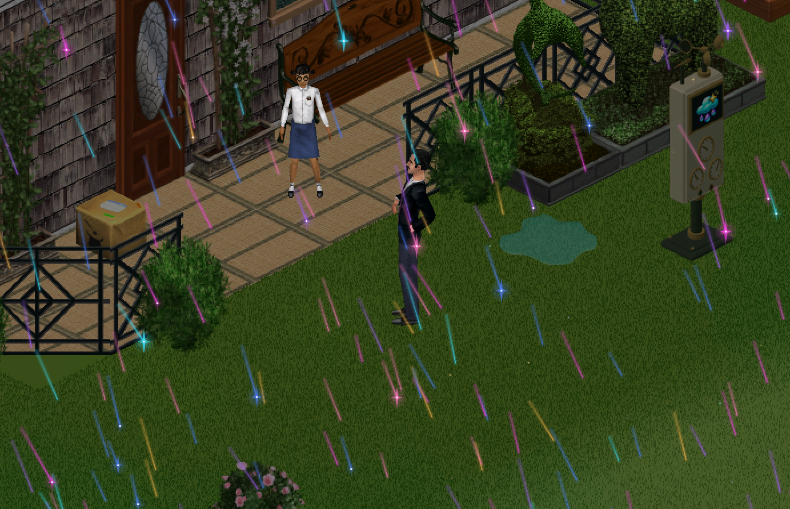

# Los Sims Cuatro Estaciones

**Primera beta pública · 1.0.0-beta.1**

<!-- quick-links -->
  
<!-- /quick-links -->

[English](../README.md) · [Polski](README.pl-PL.md) · [Dansk](README.da-DK.md) · [Deutsch](README.de-DE.md) · **Español** · [Suomi](README.fi-FI.md) · [Français](README.fr-FR.md) · [Italiano](README.it-IT.md) · [日本語](README.ja-JP.md) · [한국어](README.ko-KR.md) · [Norsk bokmål](README.nb-NO.md) · [Nederlands](README.nl-NL.md) · [Português (Brasil)](README.pt-BR.md) · [Svenska](README.sv-SE.md) · [ไทย](README.th-TH.md) · [简体中文](README.zh-CN.md) · [繁體中文](README.zh-TW.md)

Con esta expansión creada por aficionados para The Sims Legacy Collection, cada familia tiene su propio calendario estacional y su previsión del tiempo. Los fines de semana se descansa del trabajo y de las clases. La lluvia riega el jardín, un Sim que pase mucho tiempo empapado puede enfermar y, cuando se acumula suficiente nieve, la familia puede hacer un muñeco de nieve. Dos hechizos nuevos permiten a los Sims con varita invocar fenómenos meteorológicos mágicos en su solar.

*Un solar de invierno con tejados y plantas nevados*

[Capturas de pantalla](#gallery) · [Galería completa (ZIP, 9 imágenes)](https://github.com/TS1-Mod-Studio/The-Sims-1-Four-Seasons/releases/download/v1.0.0-beta.1/The-Sims-1-Four-Seasons-Screenshots.zip)

## El tiempo en tu solar

### La semana, las estaciones y la previsión de mañana

- La semana va de lunes a domingo. Los sábados y domingos los niños no tienen clase y los Sims que trabajan tienen el fin de semana libre. No pasan ni el autobús escolar ni el coche que los lleva al trabajo. Esos días no cuentan como faltas laborales. También se tienen en cuenta los turnos de noche.
- Cada solar residencial tiene su propio calendario. Por defecto, la primavera, el verano, el otoño y el invierno duran siete días de juego cada uno. Puedes elegir estaciones de 14 o 28 días para alargar el año. Abre el calendario con **Ctrl+Alt+R** para ajustar la estación, el día de la estación, el día de la semana y la hora. La partida de la familia conserva el tiempo y el calendario.
- El panel de previsión se puede plegar y muestra el día de la semana, la estación, la temperatura y el tiempo actual. Para mañana distingue cuatro periodos: madrugada, mañana, tarde y noche. Con la meteorología automática, los Sims también pueden ver la previsión en los televisores compatibles.
- Cuando la familia visita un solar comunitario normal, mantiene el tiempo y el día de la estación que tenía en casa. La isla de vacaciones tiene sus propios climas. En la montaña es invierno, en el bosque es primavera y en la playa es verano. Al volver, el calendario de casa continúa donde lo dejaste.

### El tiempo en el jardín y en casa

- La lluvia, las tormentas, el granizo, la nieve, las ventiscas y la niebla pueden aparecer por sí solos. Después de llover puede formarse niebla. El viento arrastra la lluvia y las hojas de otoño por el solar. Tras los relámpagos se oye el trueno, el agua escurre de los tejados y la lluvia normal puede apagar un incendio al aire libre, incluso si lo ha provocado un rayo.
- La lluvia riega las plantas que están a cielo abierto. Las granizadas fuertes pueden dañar las plantas ornamentales de exterior. Por la noche, sobre todo en verano, aparecen luciérnagas cerca de los arbustos y las flores. En otoño cambia el color del follaje. En invierno, la nieve cubre el césped, los tejados, las carreteras, las vallas, las plantas, los objetos de exterior y las lápidas. Se derrite poco a poco cuando sube la temperatura.
- Los Sims, los perros y los gatos se mojan al aire libre y se secan más deprisa bajo techo. Pueden buscar refugio o dejar un pequeño charco que se puede fregar. Un Sim que pase mucho tiempo empapado puede enfermar, toser y estornudar. Se recuperará en un lugar seco. Los niños pueden chapotear por iniciativa propia en los charcos del exterior. También puedes pedirles a niños y adultos que jueguen en ellos.
- Cuando hiela, los Sims dan una vuelta para ponerse la ropa de invierno al salir y recuperan su ropa anterior al entrar. Usan el conjunto que compraron. Si un Sim aún no tiene uno, se le asigna uno al azar que conservará para las siguientes salidas. Compra por **1 §** un lugar para construir un muñeco de nieve y colócalo al aire libre. Cuando la cobertura de nieve alcance el **60 %**, los Sims podrán construirlo allí, también en solares comunitarios y vacacionales. En ese lugar crecen flores silvestres mientras las plantas estén libres de nieve. Las flores se convierten en un montón cuando la nieve cubre las plantas.

### Dos conjuros nuevos en el libro de hechizos

Un Sim adulto con varita puede preparar ambas recetas en el cargador de varitas. Añade una unidad de cada ingrediente. Cada preparación da **tres cargas**. Selecciona **Lanzar conjuro…** en el cargador. Si el conjuro tiene éxito, habrá tiempo mágico durante **tres horas de juego**, incluso en un solar sin estación meteorológica.

- **Niebla del encantamiento** se prepara con Polvo de duendecillo, Lágrimas de dragón y Setas. Los gnomos de jardín y los espantapájaros pueden cobrar vida, los flamencos de adorno pueden convertirse en bailarines, las piezas de ajedrez y de damas juegan solas y las puertas de la nevera pueden moverse por sí mismas. Pueden brotar setas que se pueden recoger. Entre las **22:00 y las 06:00** aumenta la actividad de los fantasmas en las tumbas donde pueden aparecer. Mientras dura la niebla, los objetos compatibles pueden satisfacer las necesidades de energía, diversión, higiene, vejiga y hambre **un 50 % más deprisa**. Con los objetos de aprendizaje se desarrollan las habilidades **al doble de velocidad**. Puedes ajustar la frecuencia de los sucesos mágicos y activar cada bonificación por separado.
- **Lluvia del encantamiento** se prepara con Polvo de duendecillo, Lágrimas de dragón y Confeti de payaso. Las gotas de colores dejan charcos animados con los tonos del arcoíris. La lluvia riega y revitaliza las plantas vivas a cielo abierto, y puede hacer madurar los cultivos. En la hierba libre pueden crecer hasta **siete** de los cristales de habilidad originales de *Magia Potagia*. Permanecen allí después de la lluvia y, al madurar, pueden enseñar sus habilidades a los Sims.
- El tiempo mágico también puede darse de forma natural. En Ciudad Mágica es más frecuente la niebla mágica, sobre todo por la noche. Fuera del invierno, también es más probable que caiga lluvia mágica.

### Estación meteorológica, ajustes y sonido

- **Conseguir la estación meteorológica.** Solo se consigue como recompensa, una vez por familia. Se concede cuando un mismo Sim alcanza **10 puntos de Lógica y 10 de Mecánica**. Aparecerá un mensaje y encontrarás la estación en una casilla libre al aire libre en el solar residencial. Si el jardín está lleno, deja un hueco. La estación acompaña a la familia cuando se muda.
- **Usar la estación.** Selecciona a un Sim con al menos **7 puntos de Lógica y 6 de Mecánica** y haz clic en la estación. Puedes elegir la intensidad de la lluvia, las tormentas, el granizo, las nevadas y las ventiscas, o la densidad de la niebla. La lluvia mágica y la niebla mágica tienen sus propios controles. También puedes detener el fenómeno en curso, cambiar de estación del año o elegir el día de la semana. Un Sim que aún esté aprendiendo puede consultar los requisitos. El tiempo cambia automáticamente desde que cargas el solar.
- El panel permite activar por separado los efectos de mojarse, las reacciones a la lluvia, las enfermedades, la ropa de invierno, la búsqueda de refugio ante el granizo, los charcos de lluvia, los charcos que se forman al secarse, los juegos en charcos, los muñecos de nieve, la extinción de incendios por la lluvia y la niebla después de llover. También puedes ajustar los efectos, el sonido y el rendimiento de la animación. El tiempo sigue la pausa, la velocidad del juego, el zoom y la cámara.
- El mod incluye pantallas de carga traducidas y un tema original para la carga, *Pocztówka z doliny*.

## Descarga e instalación

Necesitas tener instalada la versión completa de The Sims Legacy Collection **1.10.0** o **1.10.7** en Windows de 64 bits, además de [Microsoft .NET Desktop Runtime 10 (x64)](https://dotnet.microsoft.com/download/dotnet/10.0). Reserva varios GB de espacio libre y espacio adicional para una copia de tus partidas guardadas.

1. Abre [Releases](https://github.com/TS1-Mod-Studio/The-Sims-1-Four-Seasons/releases/tag/v1.0.0-beta.1) en GitHub, selecciona la versión **1.0.0-beta.1** y descarga `The-Sims-1-Four-Seasons-1.0.0-beta.1.zip` en **Assets**.
2. Guarda la partida y cierra el juego y la aplicación del tiempo. Extrae todo el ZIP en una carpeta nueva. Deja la carpeta `data` junto a `Setup.exe`.
3. Ejecuta `Setup.exe` y selecciona la carpeta del juego que contiene `sims.exe`. Pulsa **Comprobar compatibilidad** y después **Instalar**. El instalador verifica los archivos, hace copias de seguridad y aplica los parches a los archivos de tu juego. Si detecta un conflicto en un archivo necesario, detiene la instalación.
4. Espera a que termine. Para jugar, utiliza el acceso directo **The Sims Cztery Pory Roku** del escritorio o `Launch-weather.cmd` en la carpeta de la aplicación instalada. Así se inician juntos el juego, el tiempo y el componente que recupera el tiempo de la partida guardada.

Deja que el instalador aplique los parches a los archivos del juego. Comprueba sus sumas de verificación antes y después de cada cambio y conserva `sims.exe` intacto. Solo modifica los objetos opcionales si ya tienes instalada una versión compatible de esos objetos.

## La aplicación del tiempo para Windows

El acceso directo del mod abre la aplicación del tiempo junto con el juego. Pulsa `Ctrl+Alt+R` mientras juegas o haz doble clic en el icono del tiempo junto al reloj de Windows para abrir los ajustes. Puedes usarlos con cualquier familia, incluso antes de que un Sim consiga la estación.

Elige un ajuste predefinido de precipitaciones o cambia detalles como la cantidad de gotas de lluvia, el tamaño de los copos de nieve o el volumen del viento durante una tormenta. También puedes ajustar el viento y la nubosidad en el solar y volver al modo automático. En el calendario se pueden cambiar la duración de las estaciones, el día y la hora del solar residencial activo. Las opciones de juego permiten elegir cómo afecta el tiempo a los Sims y sus mascotas. Si lo prefieres, puedes limitar los efectos meteorológicos a 30 fotogramas por segundo.

Los menús de los objetos usan el idioma del juego. La aplicación también lo utiliza de forma predeterminada. Si eliges otro idioma para la aplicación, el cambio se aplicará la próxima vez que la abras.

## Copias de seguridad, actualizaciones y desinstalación

El instalador hace copias de los archivos afectados, de tus partidas guardadas y de los datos del tiempo. Conserva `backups` y `install-state.json` en la carpeta de la aplicación, dentro de `%LOCALAPPDATA%\TS1CzteryPoryRoku`. Los datos del tiempo de los solares también se guardan en `%LOCALAPPDATA%\TS1RainOverlay`. Puedes restaurar las partidas manualmente con el juego cerrado. Deja las carpetas del juego y de la aplicación en su ubicación original.

La copia incluye `Electronic Arts\The Sims 25` en la carpeta de partidas guardadas de Windows y las carpetas `UserData`, `UserData2` que haya en el directorio del juego. Cada copia tiene su propia carpeta. Consulta en `save-backup.json` las rutas originales y las sumas de verificación para identificar los archivos que quieres recuperar.

Para actualizar el mod, cierra el juego y la aplicación del tiempo, extrae el nuevo ZIP en otra carpeta y selecciona la misma carpeta del juego en el nuevo instalador. Para quitar el mod, cierra ambos programas y elige **Opciones → Desinstalar** en la copia de `Setup.exe` que hayas conservado. Se restauran los archivos originales y se conservan las partidas y sus copias de seguridad. Si piensas volver a usar los objetos del mod, guarda una copia del solar antes de jugar sin él.

Si se interrumpe la instalación, elige **Opciones → Revertir cambios**. Si al restaurar aparece un aviso de que un archivo ha cambiado, conserva el mensaje y las copias de seguridad. Si Windows deniega el acceso de escritura, ejecuta `Setup.exe` como administrador desde la misma cuenta de Windows.

<!-- gallery -->

## Capturas de pantalla

**Ajustes del tiempo · Lluvia**

| Lluvia de otoño | Niebla en el solar |
| --- | --- |
|  |  |

| Granizo en el jardín | Niebla mágica |
| --- | --- |
|  |  |

| Lluvia y charcos mágicos | Pantalla de carga en inglés |
| --- | --- |
|  |  |

**Pronóstico para mañana**

<!-- /gallery -->

## Pruebas de la beta y errores

Las pruebas del instalador abarcan las dos versiones compatibles del juego. Agradecemos las pruebas en otros equipos, en ordenadores menos potentes y en partidas largas en cualquiera de los 17 idiomas. Si los efectos meteorológicos van lentos con la superposición de NVIDIA activada, prueba a desactivarla.

Comunica los problemas en [Issues](https://github.com/TS1-Mod-Studio/The-Sims-1-Four-Seasons/issues) en GitHub. Indica las versiones del juego y del mod, el idioma y los pasos para reproducir el fallo. Si el problema es visual, añade una captura de pantalla, el tiempo, el nivel de zoom, el ángulo de la cámara, el piso y el modo de las paredes. En caso de error de instalación, incluye el mensaje completo. Revisa los registros por si contienen rutas personales antes de compartirlos.

<!-- fan-project -->
---

Esta es una modificación no oficial creada por fans. No está afiliada a Electronic Arts ni a Maxis, ni cuenta con su aprobación o patrocinio. The Sims es una marca comercial de Electronic Arts.
