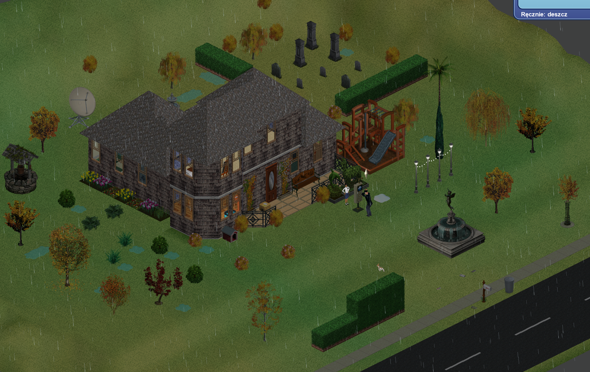

# The Sims Neljä vuodenaikaa

**Ensimmäinen julkinen beetaversio · 1.0.0-beta.1**

[English](../README.md) · [Polski](README.pl-PL.md) · [Dansk](README.da-DK.md) · [Deutsch](README.de-DE.md) · [Español](README.es-ES.md) · **Suomi** · [Français](README.fr-FR.md) · [Italiano](README.it-IT.md) · [日本語](README.ja-JP.md) · [한국어](README.ko-KR.md) · [Norsk bokmål](README.nb-NO.md) · [Nederlands](README.nl-NL.md) · [Português (Brasil)](README.pt-BR.md) · [Svenska](README.sv-SE.md) · [ไทย](README.th-TH.md) · [简体中文](README.zh-CN.md) · [繁體中文](README.zh-TW.md)

Neljä vuodenaikaa The Sims Legacy Collectioniin. Ukkoskuuro voi ajaa simit sisälle, ja tuore lumi peittää pihan. Kun lataat tallennetun pelin, myös tontin sää ja kalenteri palautuvat. Tämä on fanien tekemä epävirallinen modi.

[Kuvakaappaukset](#gallery) · [Koko galleria (ZIP, 8 kuvaa)](https://github.com/TS1-Mod-Studio/The-Sims-1-Four-Seasons/releases/download/v1.0.0-beta.1/The-Sims-1-Four-Seasons-Screenshots.zip)

## Sää tontillasi

### Viikonpäivät, vuodenajat ja huomisen sää

- Viikko alkaa maanantaina ja päättyy sunnuntaina. Lauantai ja sunnuntai ovat vapaita koulusta ja töistä. Koulubussi ja työkyyti eivät tule viikonloppuna, eikä vapaapäivistä kerry poissaoloja. Kalenteri ottaa myös yövuorot huomioon.
- Jokaisella kotitontilla on oma kalenterinsa. Kevät, kesä, syksy ja talvi kestävät oletuksena kukin **7 simpäivää**. Voit valita myös **14 tai 28 päivää**. Avaa kalenteri näppäimillä **Ctrl+Alt+R** ja muuta vuodenaikaa, sen päivää, viikonpäivää tai kellonaikaa. Sää ja kalenteri tallentuvat perheen mukana.
- Kokoon taitettava sääpaneeli näyttää viikonpäivän, vuodenajan, lämpötilan ja nykyisen sään. Huomisen ennuste jakautuu yöhön, aamuun, iltapäivään ja iltaan. Automaattisessa säätilassa simit voivat katsoa ennusteen myös tuetuista televisioista.
- Tavalliselle yhteisötontille siirryttäessä sää ja vuodenajan vaihe seuraavat perhettä. Lomasaarella vuoristossa on talvi, metsässä kevät ja rannalla kesä. Kotitontin kalenteri jatkuu palatessa lähtöpäivästä.

### Sää puutarhassa ja simien arjessa

- Sadetta, ukkosta, rakeita, lunta, lumimyrskyjä ja sumua esiintyy automaattisesti. Sateen jälkeen voi nousta sumu. Tuuli kuljettaa pisaroita ja syksyn lehtiä. Salamaa seuraa jyrähdys, katoilta valuu vettä, ja sade voi sammuttaa taivasalla palavan tulen, myös salaman sytyttämän.
- Sade kastelee suojattomat kasvit, ja voimakas raekuuro voi vahingoittaa koristekasveja. Öisin pensaiden ja kukkien luona näkyy tulikärpäsiä, varsinkin kesällä. Syksyllä lehdet saavat ruskavärit ja putoavat. Talvella syntyy kuuraa, ja lumi peittää maan, katot, tiet, aidat, kasvit, pihatavarat ja hautakivet. Sään lämmetessä lumi sulaa.
- Simit, koirat ja kissat kastuvat ulkona ja kuivuvat nopeammin katon alla. Ne voivat hakeutua suojaan ja jättää kuivuessaan mopattavan lätäkön. Pitkään läpimärkänä ollut sim voi sairastua, yskiä ja aivastella. Hän toipuu kuivassa paikassa. Lapset voivat mennä oma-aloitteisesti leikkimään lätäkköön. Myös aikuiset voivat käskystä loiskutella huvikseen.
- Pakkasella simit voivat vaihtaa ulkona talvivaatteisiin. Osta **§1** maksava lumiukon rakennuspaikka pihalle. Kun lumipeite yltää **60 prosenttiin**, siinä voi rakentaa lumiukon myös yhteisö- ja lomatonteilla.

### Kaksi uutta loitsua loitsukirjaan

Taikasauvan omistava aikuinen sim valmistaa loitsun sauvan latauslaitteessa. Yksi kappale kutakin ainesta antaa **kolme latausta**. Valitse loitsu latauslaitteesta. Onnistunut loitsu tuo taikasään **kolmeksi simtunniksi** myös tontille, jolla ei ole sääasemaa.

- **Lumouksen sumu** tarvitsee ainekset Keijupöly, Lohikäärmeen kyyneleet ja Myrkkysienet. Puutarhatontut ja linnunpelättimet voivat herätä eloon, flamingokoristeista tulla tanssijoita, shakki- ja tammilaudat pelata itsekseen ja jääkaapin ovet liikkua. Pihalle voi kasvaa kerättäviä sieniä. Sopivien hautojen luona aaveet voivat aktivoitua **kello 22–6**. Tuetuilla esineillä simin energia-, huvi-, hygienia-, rakko- ja nälkätarpeet voivat täyttyä **50 % nopeammin** ja taidot karttua **kaksinkertaisella nopeudella**. Taikatapahtumien yleisyyttä ja yksittäisiä etuja voi säätää.
- **Lumouksen sade** tarvitsee ainekset Keijupöly, Lohikäärmeen kyyneleet ja Pelleserpentiini. Värikkäät pisarat muodostavat liikkuvia sateenkaarilätäköitä. Sade kastelee taivasalla olevia eläviä kasveja, parantaa niiden kuntoa ja voi kypsyttää viljelypalstan sadon. Vapaalle nurmelle voi kasvaa enintään **seitsemän** pelin alkuperäistä taikakykykristallia. Ne jäävät paikoilleen sateen jälkeen ja opettavat kykynsä täysikasvuisina.
- Taikasäätä voi esiintyä myös itsestään. Taikakaupungissa taikasumu on tavallista yleisempää etenkin öisin, ja siellä sataa useammin taikasadetta talven ulkopuolella.

### Sääasema, asetukset ja äänet

- Automaattinen sää toimii ilman hankintoja. **§10 000** maksavalla sääasemalla voi muuttaa säätä ja kalenteria, kun simillä on **7 logiikka- ja 6 mekaniikkapistettä**. Jos sama sim saa **10 pistettä molemmissa taidoissa**, perhe voi saada yhden sääaseman palkinnoksi.
- Sääpaneelista voi säätää erikseen kastumista, sadereaktioita, sairautta, talvivaatetusta, rakeilta suojautumista, sateen tai kuivumisen synnyttämiä lätäköitä, loiskuttelua, lumiukkoja, tulipalojen sammumista sateessa ja sateenjälkeistä sumua. Myös tehosteita, ääniä ja animaation suorituskykyä voi säätää. Sää seuraa taukoa, pelinopeutta, zoomausta ja kameraa.
- Modissa on käännetyt latausruudut sekä oma latausmusiikki, *Pocztówka z doliny*.

## Lataus ja asennus

Tarvitset 64-bittisen Windowsin, asennetun The Sims Legacy Collectionin täysversion **1.10.0** tai **1.10.7** sekä [Microsoft .NET Desktop Runtime 10 (x64)](https://dotnet.microsoft.com/download/dotnet/10.0) -ajoympäristön. Varaa useita gigatavuja vapaata levytilaa sekä tilaa tallennustesi varmuuskopiolle.

1. Avaa GitHub-projektin [Releases](https://github.com/TS1-Mod-Studio/The-Sims-1-Four-Seasons/releases/tag/v1.0.0-beta.1), valitse julkaisu **1.0.0-beta.1** ja lataa `TheSimsCzteryPoryRoku-1.0.0-beta.1.zip` kohdasta **Assets**.
2. Tallenna peli ja sulje sekä peli että sääohjelma. Pura koko ZIP-paketti uuteen kansioon. Jätä `data` samaan kansioon kuin `Setup.exe`.
3. Käynnistä `Setup.exe` ja valitse pelikansio, jossa `sims.exe` sijaitsee. Valitse ensin **Tarkista yhteensopivuus** ja sitten **Asenna**. Asennusohjelma tarkistaa tiedostot, tekee varmuuskopiot ja päivittää oman peliasennuksesi tiedostot. Asennus keskeytyy, jos jokin vaadituista tiedostoista ei ole yhteensopiva.
4. Odota, että asennus valmistuu. Käynnistä peli jatkossa työpöydän **The Sims Cztery Pory Roku** -pikakuvakkeesta tai asennetun sääohjelman kansiossa olevalla `Launch-weather.cmd`-tiedostolla. Näin myös sääohjelma ja tallennusten sään palauttava osa käynnistyvät.

Anna asennusohjelman päivittää pelitiedostot. Se tarkistaa tiedostojen tarkistussummat ennen muutoksia ja niiden jälkeen. `sims.exe` säilyy ennallaan. Valinnaiset esineet päivitetään vain, jos niiden tuettu versio on jo asennettu.

## Pelaaminen

Kun lataat tontin, sää vaihtuu automaattisesti. Pikanäppäimellä `Ctrl+Alt+R` voit säätää sateita, ääntä, kalenteria ja sään vaikutuksia pelaamiseen. Esineiden valikot seuraavat pelin kieltä. Myös sääpaneeli käyttää oletuksena pelin kieltä. Jos valitset paneelille toisen kielen, muutos tulee voimaan seuraavalla käynnistyskerralla.

## Varmuuskopiot, päivitykset ja poistaminen

Asennusohjelma varmuuskopioi käsiteltävät tiedostot, pelitallennukset ja säätiedot. Säilytä `backups` ja `install-state.json` asennetun ohjelman omassa kansiossa kohteessa `%LOCALAPPDATA%\TS1CzteryPoryRoku`. Tonttien säätietoja on myös kansiossa `%LOCALAPPDATA%\TS1RainOverlay`. Voit palauttaa tallennukset varmuuskopioista itse, kun peli on suljettu. Pidä peli ja sääohjelma alkuperäisissä asennuskansioissaan.

Varmuuskopioon sisältyvät Windowsin tallennettujen pelien kansiossa sijaitseva `Electronic Arts\The Sims 25` sekä pelikansiossa mahdollisesti olevat `UserData`, `UserData2`-kansiot. Jokaisella varmuuskopiolla on oma kansio. Tiedostossa `save-backup.json` näkyvät alkuperäiset polut ja tarkistussummat, joiden avulla löydät palautettavat tiedostot.

Kun päivität modin, sulje peli ja sääohjelma, pura uusi ZIP-paketti erilliseen kansioon ja valitse uudessa asennusohjelmassa sama pelikansio. Kun haluat poistaa modin, sulje molemmat ohjelmat, käynnistä säilyttämäsi `Setup.exe` ja valitse **Asetukset → Poista asennus**. Alkuperäiset tiedostot palautetaan, ja tallennukset ja varmuuskopiot säilyvät. Jos aiot käyttää modin esineitä myöhemmin uudelleen, säilytä tontista kopio ajalta ennen pelaamista ilman modia.

Jos asennus keskeytyi, valitse **Asetukset → Kumoa muutokset**. Jos palautus ilmoittaa muuttuneesta tiedostosta, säilytä ilmoitus ja varmuuskopiot. Jos Windows estää tiedostojen kirjoittamisen, suorita `Setup.exe` järjestelmänvalvojana samalla Windows-käyttäjätilillä.

<!-- gallery -->

## Kuvakaappaukset

| Syksyinen sade | Tontti sumun peitossa |
| --- | --- |
|  |  |

| Raesade puutarhassa | Taikasumu |
| --- | --- |
|  |  |

| Taikasade ja lätäköt | Englanninkielinen latausruutu |
| --- | --- |
|  |  |

**Huomisen sääennuste**

<!-- /gallery -->

## Beetatestaus ja virheraportit

Asennustestit kattavat molemmat tuetut peliversiot. Palaute muunlaisilta tietokoneilta, heikommalta laitteistolta ja pidemmistä pelikerroista kaikilla 17 kielellä on tervetullutta. Jos säätehosteet nykivät NVIDIA-peittokuvan ollessa käytössä, kokeile peliä myös peittokuva poistettuna käytöstä.

Ilmoita virheestä GitHubin [Issues](https://github.com/TS1-Mod-Studio/The-Sims-1-Four-Seasons/issues)-osiossa. Kerro pelin ja modin versiot, kieli sekä vaiheet, joilla ongelman voi toistaa. Jos ongelma näkyy ruudulla, liitä kuvakaappaus ja kerro sää, zoomaus, kameran kulma, kerros ja seinien näyttötapa. Liitä asennusongelmista koko virheilmoitus. Tarkista lokit henkilökohtaisten tiedostopolkujen varalta ennen jakamista.
