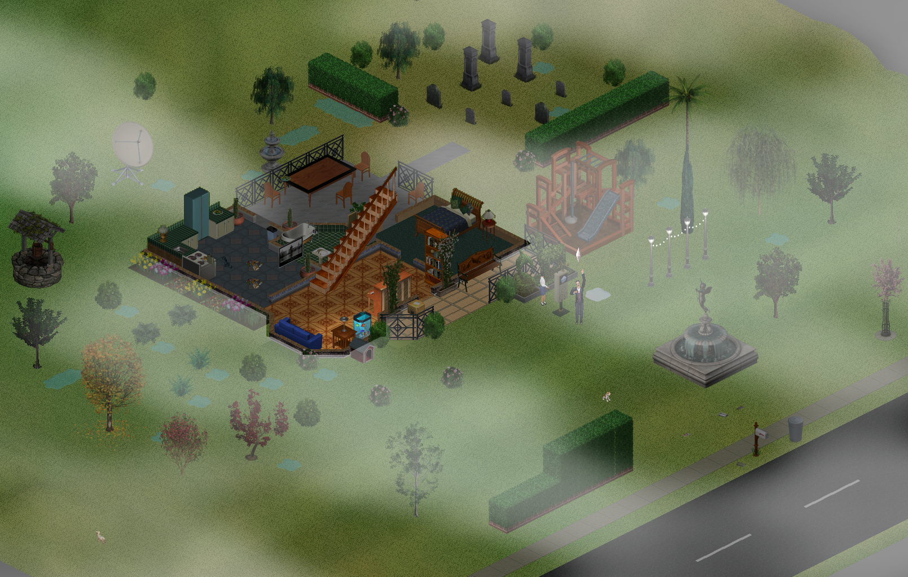

# The Sims Fire årstider

**Første offentlige betaversjon · 1.0.0-beta.1**

[English](../README.md) · [Polski](README.pl-PL.md) · [Dansk](README.da-DK.md) · [Deutsch](README.de-DE.md) · [Español](README.es-ES.md) · [Suomi](README.fi-FI.md) · [Français](README.fr-FR.md) · [Italiano](README.it-IT.md) · [日本語](README.ja-JP.md) · [한국어](README.ko-KR.md) · **Norsk bokmål** · [Nederlands](README.nl-NL.md) · [Português (Brasil)](README.pt-BR.md) · [Svenska](README.sv-SE.md) · [ไทย](README.th-TH.md) · [简体中文](README.zh-CN.md) · [繁體中文](README.zh-TW.md)

Denne fanlagde modden gir hver husstand i The Sims Legacy Collection et år med fire årstider og en uke med fri fra skole og jobb i helgene. Om høsten skifter trærne farge, og om vinteren legger snøen seg i hagen. Simmene kan se morgendagens værmelding på TV, plaske i sølepytter, bygge snømenn og lære to trylleformler som forandrer været.

[Skjermbilder](#gallery) · [Hele galleriet (ZIP, 8 bilder)](https://github.com/TS1-Mod-Studio/The-Sims-1-Four-Seasons/releases/download/v1.0.0-beta.1/The-Sims-1-Four-Seasons-Screenshots.zip)

## Været på tomten

### Uken, årstidene og værmeldingen for i morgen

- Uken går fra mandag til søndag. På lørdager og søndager har barna fri fra skolen, og simmene som jobber, har fri fra arbeidet. Verken skolebussen eller bilen som henter simmene til jobb, kommer. Helgen teller ikke som fravær fra jobben. Kalenderen tar også hensyn til nattskift.
- Hver boligtomt har sin egen kalender. Vår, sommer, høst og vinter varer som standard sju dager i spillet hver. Du kan velge 14 eller 28 dager per årstid hvis du vil ha et lengre år. I kalenderen under **Ctrl+Alt+R** kan du stille inn årstid, dag i årstiden, ukedag og klokkeslett. Været og kalenderen lagres sammen med husstanden.
- Værpanelet kan foldes sammen. Det viser ukedag, årstid, temperatur og været akkurat nå. Morgendagens værmelding er delt inn i natt, morgen, ettermiddag og kveld. Med automatisk vær kan simmene også se værmeldingen på TV-apparater som støtter det.
- Når familien drar til en vanlig fellestomt, følger været og dagen i årstiden med hjemmefra. Ferieøya har sine egne klimaer. Det er vinter på fjellet, vår i skogen og sommer på stranden. Kalenderen hjemme fortsetter der den slapp når familien kommer tilbake.

### Været i hagen og i huset

- Regn, tordenvær, hagl, snø, snøstorm og tåke kan komme av seg selv. Etter regn kan det legge seg tåke. Vinden driver regn og høstløv over tomten. Etter lynet kommer tordenen, vannet renner fra takene, og vanlig regn kan slukke en brann under åpen himmel, også en som er startet av et lynnedslag.
- Regnet vanner planter under åpen himmel. Kraftig hagl kan skade prydplanter utendørs. Om natten lyser ildfluer ved busker og blomster, særlig om sommeren. Om høsten skifter løvet farge. Om vinteren legger snøen seg på bakken, tak, veier, gjerder, planter og gjenstander utendørs, også på gravsteiner. Når været blir mildere, smelter snøen igjen.
- Simmer, katter og hunder blir våte utendørs og tørker raskere under tak. De kan søke ly eller etterlate en liten dam som en sim kan tørke opp. En sim som er gjennomvåt lenge, kan bli syk, hoste og nyse. Simmen kan bli frisk igjen på et tørt sted. Barn kan plaske i sølepytter utendørs på eget initiativ. Du kan også be både voksne og barn om å plaske for moro skyld.
- Når det er minusgrader, snurrer simmene rundt og skifter til vinterklær ute. Inne skifter de tilbake. De bruker vinterantrekket de har kjøpt. En sim som ikke har kjøpt et vinterantrekk, får et tilfeldig antrekk og bruker det også på senere turer. Kjøp en plass for å bygge en snømann for **1 §**, og plasser den ute. Når snødekket når **60 %**, kan simmene bygge en snømann der, også på fellestomter og ferietomter. Det vokser ville blomster på plassen når plantene er snøfrie. Når plantene dekkes av snø, blir blomstene til en snøhaug.

### To nye trylleformler i trolldomsboken

En voksen sim med tryllestav kan tilberede begge oppskriftene i tryllestavladeren. Bruk én av hver ingrediens. Hver porsjon gir **tre ladninger**. Velg **Kast trylleformel…** på laderen. En vellykket trylleformel gir **tre timer i spillet** med magisk vær, også på en tomt uten værstasjon.

- Til **Fortryllelsens tåke** trenger du Fe-støv, Dragetårer og Fluesopp. Hagenisser og fugleskremsler kan våkne til liv, hageflamingoer kan forvandles til dansere, sjakk- og dambrikker kan spille av seg selv, og kjøleskapsdører kan bevege seg uten hjelp. Det kan vokse opp fluesopp som simmene kan plukke. Ved graver der spøkelser kan vise seg, øker aktiviteten mellom **kl. 22 og 6**. Så lenge tåken ligger der, kan gjenstander som støttes, dekke behovene for energi, moro, hygiene, toalettbesøk og mat **50 % raskere**. Med gjenstander som trener ferdigheter, lærer simmene **dobbelt så fort**. Du kan justere hvor ofte magiske hendelser inntreffer og slå de enkelte bonusene av og på.
- Til **Fortryllelsens regn** trenger du Fe-støv, Dragetårer og Klovnekonfetti. Fargede regndråper etterlater animerte sølepytter i regnbuens farger. Regnet vanner og styrker levende planter under åpen himmel og kan få avlinger til å modne. Opptil **sju** av de opprinnelige evnekrystallene fra *Makin’ Magic* kan vokse på ledige gressflater. De blir stående etter bygen, og når de er utvokst, kan simmene lære evnene deres.
- Magisk vær kan også oppstå naturlig. I Magic Town er magisk tåke vanligere, særlig om natten. Utenom vinteren er det også større sjanse for magisk regn der.

### Værstasjon, innstillinger og lyd

- **Slik får husstanden en værstasjon.** Når én og samme sim når **10 i både logikk og mekanikk**, får husstanden en stasjon som engangsbelønning. Den plasseres på en ledig plass utendørs på boligtomten. Stasjonen kan bare fås som belønning. Det automatiske været fungerer fra første dag.
- **Slik bruker simmene stasjonen.** En sim som ennå mangler de nødvendige ferdighetene, kan sjekke kravene ved stasjonen. Med minst **7 i logikk og 6 i mekanikk** kan simmen velge årstid og ukedag eller sette i gang regn, tordenvær, hagl, snø, snøstorm, tåke, magisk regn eller magisk tåke. Hver værtype har tre styrkegrader og kan slås av igjen.
- I værpanelet kan du styre virkningene enkeltvis. Du kan blant annet velge om simmene blir våte, reagerer på regn, blir syke, tar på vinterklær eller søker ly for hagl. Det finnes egne brytere for sølepytter etter regn, dammer som blir igjen når noen tørker, plasking, snømenn, regn som slukker branner og tåke etter regn. Du kan også justere effekter, lyd og animasjonsytelse. Været følger spillets pauser, hastighet, zoom og kamera.
- Modden inneholder oversatte innlastingsskjermer og en original melodi til innlastingen, *Pocztówka z doliny*.

## Nedlasting og installasjon

Du trenger fullversjonen av The Sims Legacy Collection **1.10.0** eller **1.10.7** installert på 64-biters Windows, samt [Microsoft .NET Desktop Runtime 10 (x64)](https://dotnet.microsoft.com/download/dotnet/10.0). Sett av flere GB ledig plass i tillegg til plass til en kopi av de lagrede spillene dine.

1. Åpne [Releases](https://github.com/TS1-Mod-Studio/The-Sims-1-Four-Seasons/releases/tag/v1.0.0-beta.1) på prosjektets GitHub-side, velg **1.0.0-beta.1** og last ned `TheSimsCzteryPoryRoku-1.0.0-beta.1.zip` under **Assets**.
2. Lagre spillet og lukk både spillet og værprogrammet. Pakk ut hele ZIP-filen i en ny mappe. La mappen `data` ligge ved siden av `Setup.exe`.
3. Kjør `Setup.exe` og velg spillmappen som inneholder `sims.exe`. Velg **Sjekk kompatibilitet** og deretter **Installer**. Installasjonsprogrammet kontrollerer og sikkerhetskopierer filene før det gjør endringer i dine egne spillfiler. En konflikt i en nødvendig fil stopper installasjonen.
4. Vent til installasjonen er ferdig. Start deretter spillet med skrivebordssnarveien **The Sims Cztery Pory Roku** eller med `Launch-weather.cmd` i mappen til det installerte programmet. Da starter spillet sammen med været og modulen som henter tilbake været fra lagrede spill.

La installasjonsprogrammet endre spillfilene. Det kontrollerer filenes sjekksummer før og etter hver endring, og `sims.exe` forblir uendret. Valgfrie gjenstander oppdateres bare hvis du allerede har installert en versjon som støttes.

## Innstillinger i værprogrammet

Skrivebordssnarveien starter spillet, værprogrammet og tjenesten som knytter været og kalenderen på tomten til det lagrede spillet. Åpne innstillingene mens du spiller med `Ctrl+Alt+R` eller ved å dobbeltklikke på værikonet i systemstatusfeltet i Windows.

Regn, tordenvær, snø og tåke har egne faner. Her kan du blant annet justere nedbørsmengde, tåketetthet og lydnivå. Vind, skydekke og ildfluer har også egne innstillinger. I kalenderen kan du endre ukedag og årstid. Under spillinnstillinger velger du hvordan været påvirker simmene. Menyene for gjenstander og værprogrammet følger spillets språk som standard. Hvis du velger et annet språk for programmet, tas det i bruk ved neste oppstart.

## Sikkerhetskopier, oppdatering og avinstallering

Installasjonsprogrammet tar sikkerhetskopier av berørte filer, lagrede spill og værdata. Behold `backups` og `install-state.json` i programmappen under `%LOCALAPPDATA%\TS1CzteryPoryRoku`. Værdata for tomtene lagres også under `%LOCALAPPDATA%\TS1RainOverlay`. Du kan gjenopprette lagrede spill manuelt fra kopiene mens spillet er lukket. La spillmappen og programmappen ligge der de ble installert.

Sikkerhetskopien omfatter `Electronic Arts\The Sims 25` i Windows-mappen for lagrede spill og eventuelle `UserData`, `UserData2`-mapper i spillmappen. Hver sikkerhetskopi får en egen mappe. I `save-backup.json` finner du opprinnelige filbaner og sjekksummer som kan brukes til å identifisere filene du vil gjenopprette manuelt.

For å oppdatere lukker du spillet og værprogrammet, pakker ut den nye ZIP-filen i en egen mappe og velger den samme spillmappen i det nye installasjonsprogrammet. For å fjerne modden lukker du begge programmene og velger **Alternativer → Avinstaller** i kopien av `Setup.exe` du har tatt vare på. Originalfilene gjenopprettes, og du beholder lagrede spill og sikkerhetskopier. Hvis du vil bruke gjenstandene fra modden igjen senere, ta vare på en kopi av tomten fra før du spilte uten modden.

Hvis installasjonen ble avbrutt, velger du **Alternativer → Tilbakestill endringer**. Hvis gjenopprettingen melder at en fil er endret, tar du vare på meldingen og sikkerhetskopiene. Hvis Windows nekter skrivetilgang, kjører du `Setup.exe` som administrator fra den samme Windows-kontoen.

<!-- gallery -->

## Skjermbilder

| Høstregn | Tåke over tomten |
| --- | --- |
|  |  |

| Hagl i hagen | Magisk tåke |
| --- | --- |
|  |  |

| Magisk regn og sølepytter | Lasteskjermen på engelsk |
| --- | --- |
|  |  |

**Værmeldingen for i morgen**

<!-- /gallery -->

## Betatesting og feilrapporter

Installasjonen er testet på begge spillversjonene som støttes. Vi tar gjerne imot erfaringer fra andre PC-er, svakere maskinvare og lengre spilløkter på alle de 17 språkene. Hvis væreffektene hakker med NVIDIA-overlegget aktivert, kan du prøve å slå det av.

Meld feil under [Issues](https://github.com/TS1-Mod-Studio/The-Sims-1-Four-Seasons/issues) på GitHub. Oppgi spillversjon, modversjon, språk og fremgangsmåten som utløser feilen. Ved grafikkfeil hjelper det med et skjermbilde og opplysninger om vær, zoom, kameravinkel, etasje og veggvisning. Ved installasjonsfeil legger du ved hele feilmeldingen. Se etter personlige filbaner i loggene før du deler dem.
