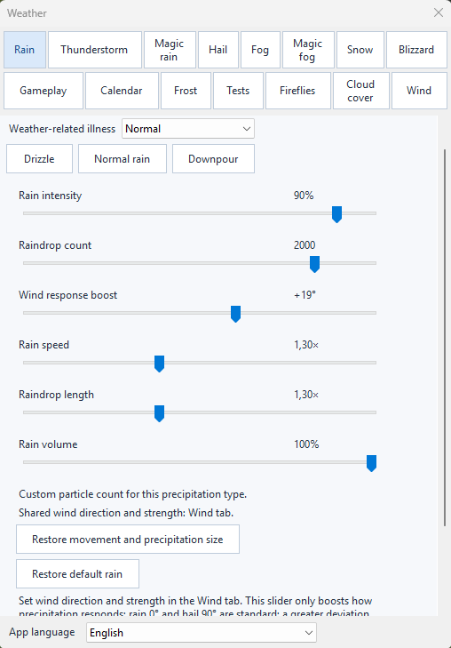

# De Sims Vier Jaargetijden

**Eerste openbare bèta · 1.0.0-beta.1**

<!-- quick-links -->
  
<!-- /quick-links -->

[English](../README.md) · [Polski](README.pl-PL.md) · [Dansk](README.da-DK.md) · [Deutsch](README.de-DE.md) · [Español](README.es-ES.md) · [Suomi](README.fi-FI.md) · [Français](README.fr-FR.md) · [Italiano](README.it-IT.md) · [日本語](README.ja-JP.md) · [한국어](README.ko-KR.md) · [Norsk bokmål](README.nb-NO.md) · **Nederlands** · [Português (Brasil)](README.pt-BR.md) · [Svenska](README.sv-SE.md) · [ไทย](README.th-TH.md) · [简体中文](README.zh-CN.md) · [繁體中文](README.zh-TW.md)

Met deze door fans gemaakte uitbreiding voor The Sims Legacy Collection krijgt elk huishouden een eigen seizoenskalender en een plaatselijke weersverwachting. In het weekend zijn je Sims vrij van school en werk. Regen geeft de tuin water, een Sim die lang doorweekt blijft kan ziek worden en bij genoeg sneeuw kan de familie een sneeuwpop maken. Sims met een toverstaf krijgen twee nieuwe spreuken waarmee ze magisch weer kunnen oproepen op hun kavel.

*Een winterkavel met besneeuwde daken en planten*

[Schermafbeeldingen](#gallery)

## Wat verandert er op je kavel?

### De week, de seizoenen en de weersverwachting

- De kalender loopt van maandag tot en met zondag. Op zaterdag en zondag zijn kinderen vrij van school en hoeven werkende Sims niet naar hun werk. De schoolbus en de carpool komen niet langs. Het weekend telt niet als verzuim, ook bij nachtdiensten.
- Elke woonkavel heeft een eigen kalender. Lente, zomer, herfst en winter duren elk standaard **7 Simdagen**. Je kunt ook **14 of 28 dagen** kiezen. In de kalender onder **Ctrl+Alt+R** stel je het seizoen, de dag van het seizoen, de weekdag en de tijd in. Als je het huishouden opslaat, blijven het weer en de kalender bewaard.
- Het inklapbare weerpaneel toont de dag, het seizoen, de temperatuur en het huidige weer. De verwachting voor morgen is verdeeld in nacht, ochtend, middag en avond. Bij automatisch weer kunnen Sims het weerbericht ook bekijken op ondersteunde televisies.
- Op een gewone openbare kavel reist het weer van het huishouden mee, net als de voortgang van het seizoen. Op het vakantie-eiland is het winter in de bergen, lente in het bos en zomer aan het strand. Bij thuiskomst gaat de kalender verder waar je gebleven was.

### Het weer in de tuin en in huis

- Regen, onweer, hagel, sneeuw, sneeuwstormen en mist kunnen vanzelf opkomen. Na regen kan mist blijven hangen. De wind blaast regen en herfstbladeren over de kavel. Na een bliksemflits hoor je de donder. Water stroomt van de daken en regen kan buiten brand blussen, ook na een blikseminslag.
- Regen geeft onbeschutte planten water. Zware hagel kan sierplanten beschadigen. Op zomeravonden heb je de meeste kans om vuurvliegjes tussen de struiken en bloemen te zien. In de herfst verkleuren en vallen de bladeren. In de winter bedekt sneeuw het gras, de daken, wegen, hekken, planten, tuinvoorwerpen en grafstenen. Bij warmer weer smelt de sneeuw.
- Sims, honden en katten worden buiten nat, zoeken soms beschutting en drogen sneller onder een dak. Ze kunnen bij het opdrogen een plasje achterlaten dat je kunt dweilen. Een doorweekte Sim kan ziek worden, hoesten en niezen, en herstelt op een droge plek. Kinderen kunnen uit zichzelf in plassen spelen. Ook volwassenen kunnen op verzoek voor hun plezier spetteren.
- Als het vriest, trekken Sims buiten met een draai hun winterkleren aan. Binnen trekken ze hun vorige outfit weer aan. Ze dragen de winteroutfit die ze hebben gekocht. Heeft een Sim er nog geen, dan krijgt die een willekeurige winteroutfit voor deze en volgende uitstapjes. Koop voor **§1** een plek om een sneeuwpop te bouwen en zet die buiten. Vanaf **60% sneeuwbedekking** kunnen ze er een sneeuwpop maken, ook op openbare kavels en op vakantie. Op die plek groeien wilde bloemen zolang de planten sneeuwvrij zijn. Als de planten besneeuwd raken, veranderen de bloemen in een hoop sneeuw.

### Twee nieuwe spreuken in het toverboek

Een volwassen Sim met een toverstaf kan de recepten in de toverstafoplader bereiden. Gebruik van elk ingrediënt één stuk voor **drie ladingen**. Kies de spreuk op de oplader. Een geslaagde spreuk brengt **drie Simuren** magisch weer, ook zonder weerstation.

- **Mist der betovering** vraagt om Elfjesstof, Drakentranen en Paddestoelen. Kabouters en vogelverschrikkers kunnen tot leven komen, tuinflamingo’s veranderen in dansers, schaak- en damborden spelen zelf en koelkastdeuren bewegen. Er kunnen plukbare paddenstoelen groeien. Bij geschikte graven worden spoken tussen **22.00 en 06.00 uur** actiever. Ondersteunde voorwerpen kunnen energie, plezier, hygiëne, blaas en honger **50% sneller** aanvullen en vaardigheden **twee keer zo snel** aanleren. De bonussen en de frequentie van magische gebeurtenissen zijn instelbaar.
- **Regen der betovering** vraagt om Elfjesstof, Drakentranen en Clownsconfetti. De gekleurde regen vormt bewegende regenboogplassen, geeft blootgestelde planten water, verbetert hun conditie en kan gewassen laten rijpen. Op open gras kunnen maximaal **zeven** oorspronkelijke magische vaardigheidskristallen groeien. Ze blijven na de bui staan en leren Sims hun vaardigheden zodra ze volgroeid zijn.
- Magisch weer komt ook vanzelf voor. In de magische stad is er vaker magische mist, vooral ’s nachts, en buiten de winter vaker magische regen.

### Weerstation, instellingen en geluid

- **Het weerstation verdienen.** Je krijgt het station uitsluitend als beloning, één keer per huishouden. Eén Sim moet **10 punten voor logica én 10 punten voor techniek** behalen. Het spel plaatst het weerstation buiten op een vrij vakje van de thuiskavel en toont een melding. Staat de tuin vol, maak dan buiten een plekje vrij. Het station verhuist mee met de familie.
- **Het weerstation bedienen.** Kies een Sim met minstens **7 punten voor logica en 6 voor techniek** en klik op het station. Je kunt kiezen hoe hard het regent, onweert, hagelt of sneeuwt, hoe hevig een sneeuwstorm is en hoe dicht de mist wordt. Magische regen en magische mist hebben elk hun eigen opties. Je kunt het huidige weerverschijnsel beëindigen, het seizoen veranderen of een dag van de week kiezen. Een Sim die nog moet oefenen, kan de vereisten opvragen. Het weer verandert automatisch zodra je een kavel laadt.
- In het weerpaneel schakel je afzonderlijk nat worden, regenreacties, ziekte, winterkleding, schuilen voor hagel, plassen door regen of opdrogen, spetteren, sneeuwpoppen, het blussen van branden en mist na regen in of uit. Je kunt effecten, geluid en animatieprestaties aanpassen. Het weer volgt de pauze, de snelheid, de zoom en de camera.
- De mod bevat vertaalde laadschermen en eigen laadschermmuziek, *Pocztówka z doliny*.

## Downloaden en installeren

Je hebt een geïnstalleerde volledige versie van The Sims Legacy Collection **1.10.0** of **1.10.7**, 64-bits Windows en [Microsoft .NET Desktop Runtime 10 (x64)](https://dotnet.microsoft.com/download/dotnet/10.0) nodig. Zorg voor enkele GB vrije ruimte en extra ruimte voor een kopie van je opgeslagen spellen.

1. Open [Releases](https://github.com/TS1-Mod-Studio/The-Sims-1-Four-Seasons/releases/tag/v1.0.0-beta.1) op de GitHub-pagina van het project, kies **1.0.0-beta.1** en download `The-Sims-1-Four-Seasons-1.0.0-beta.1.zip` onder **Assets**.
2. Sla je spel op en sluit het spel en het weerprogramma. Pak het hele ZIP-bestand uit in een nieuwe map. Laat de map `data` naast `Setup.exe` staan.
3. Start `Setup.exe` en kies de spelmap waarin `sims.exe` staat. Kies eerst **Compatibiliteit controleren** en daarna **Installeren**. Het installatieprogramma controleert de bestanden, maakt back-ups en past de wijzigingen toe op je eigen spelbestanden. Bij een conflict met een vereist bestand stopt de installatie.
4. Wacht tot de installatie klaar is. Start het spel voortaan met de snelkoppeling **The Sims Cztery Pory Roku** op het bureaublad of met `Launch-weather.cmd` in de installatiemap van het weerprogramma. Zo starten het spel en de onderdelen voor het weer en je opgeslagen spel tegelijk.

Laat het installatieprogramma de spelbestanden aanpassen. Het controleert de controlesommen voor en na het toepassen van elke patch en laat `sims.exe` intact. Optionele voorwerpen worden alleen bijgewerkt als er al een ondersteunde versie van is geïnstalleerd.

## Het weerprogramma voor Windows

Met de snelkoppeling van de mod start je het weerprogramma tegelijk met het spel. Druk tijdens het spelen op `Ctrl+Alt+R` of dubbelklik op het weerpictogram naast de Windows-klok om de instellingen te openen. Je kunt ze voor elk huishouden gebruiken, ook als nog geen enkele Sim het weerstation heeft verdiend.

Kies een standaardinstelling voor de neerslag of pas zelf het aantal regendruppels, de grootte van de sneeuwvlokken of het volume van de stormwind aan. Je kunt de wind en de bewolking op de kavel instellen en daarna de automatische regeling weer aanzetten. In de kalender verander je de lengte van de seizoenen, de dag en de tijd op de actieve thuiskavel. Met de spelopties bepaal je welke gevolgen het weer heeft voor Sims en huisdieren. Je kunt de weereffecten ook beperken tot 30 beelden per seconde.

De voorwerpmenu’s gebruiken de taal van het spel. Het weerprogramma neemt die standaard over. Kies je voor het programma een andere taal, dan gaat die in zodra je het opnieuw start.

## Back-ups, updates en verwijderen

Het installatieprogramma maakt een back-up van de betrokken bestanden, opgeslagen spellen en weergegevens. Bewaar `backups` en `install-state.json` bij elkaar in de programmamap onder `%LOCALAPPDATA%\TS1CzteryPoryRoku`. Weergegevens per kavel staan ook onder `%LOCALAPPDATA%\TS1RainOverlay`. Je kunt opgeslagen spellen handmatig terugzetten zodra je het spel hebt afgesloten. Laat de spelmap en de programmamap op hun oorspronkelijke plek staan.

De back-up bevat `Electronic Arts\The Sims 25` in de Windows-map voor opgeslagen spellen en de eventuele `UserData`, `UserData2`-mappen in de spelmap. Elke back-up krijgt een eigen map. In `save-backup.json` vind je de oorspronkelijke bestandspaden en controlesommen. Zo kun je bij handmatig herstel de juiste bestanden terugvinden.

Voor een update sluit je het spel en het weerprogramma, pak je het nieuwe ZIP-bestand uit in een aparte map en kies je bij de installatie dezelfde spelmap. Om de mod te verwijderen sluit je beide programma’s en kies je **Opties → Verwijderen** in de bewaarde `Setup.exe`. De oorspronkelijke bestanden worden hersteld. Je opgeslagen spellen en back-ups blijven bewaard. Wil je de voorwerpen uit de mod later weer gebruiken, bewaar dan een kopie van de kavel van vóór het spelen zonder de mod.

Is de installatie onderbroken, kies dan **Opties → Wijzigingen terugdraaien**. Meldt het herstelprogramma dat een bestand is gewijzigd, bewaar dan de melding en de back-ups. Als Windows schrijftoegang weigert, voer je `Setup.exe` vanuit hetzelfde Windows-account als administrator uit.

<!-- gallery -->

## Schermafbeeldingen

**Weerinstellingen · Regen**

| Herfstregen | Mist op de kavel |
| --- | --- |
|  |  |

| Hagel in de tuin | Magische mist |
| --- | --- |
|  |  |

| Magische regen en plassen | Engels laadscherm |
| --- | --- |
|  |  |

**De verwachting voor morgen**

<!-- /gallery -->

## Bèta testen en fouten melden

Het installatieprogramma is voor beide ondersteunde spelversies getest. Ervaringen op andere pc’s, op minder krachtige computers en tijdens langere speelsessies in de 17 talen zijn welkom. Hapert het weerbeeld wanneer de NVIDIA-overlay actief is, probeer het dan ook met die overlay uitgeschakeld.

Meld een probleem op GitHub onder [Issues](https://github.com/TS1-Mod-Studio/The-Sims-1-Four-Seasons/issues). Vermeld de spelversie, modversie, taal en de stappen waarmee je het probleem kunt herhalen. Voeg bij een beeldfout een schermafbeelding toe en vermeld het weer, de zoomstand, camerahoek, verdieping en muurweergave. Geef bij installatiefouten de hele foutmelding door. Controleer logbestanden voor het delen op persoonlijke bestandspaden.

<!-- fan-project -->
---

Dit is een onofficiële, door fans gemaakte modificatie. Ze is niet verbonden aan, goedgekeurd of gesponsord door Electronic Arts of Maxis. The Sims is een handelsmerk van Electronic Arts.
