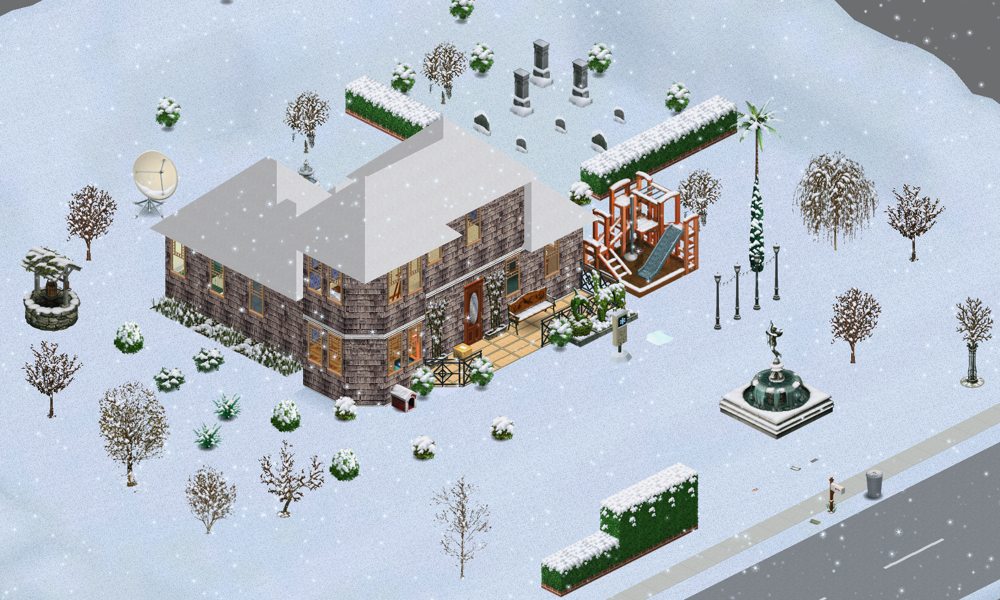
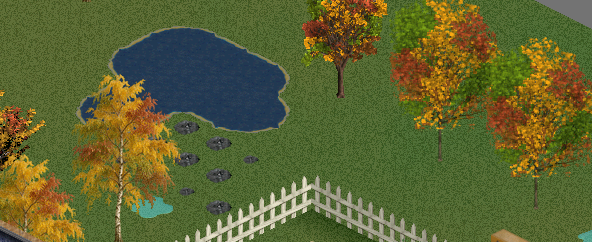
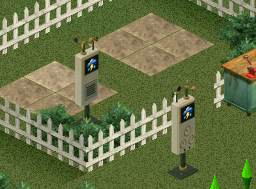

# เดอะซิมส์ สี่ฤดู

**เบต้าสาธารณะเวอร์ชันแรก · 1.0.0-beta.1**

<!-- quick-links -->
  
<!-- /quick-links -->

[English](../README.md) · [Polski](README.pl-PL.md) · [Dansk](README.da-DK.md) · [Deutsch](README.de-DE.md) · [Español](README.es-ES.md) · [Suomi](README.fi-FI.md) · [Français](README.fr-FR.md) · [Italiano](README.it-IT.md) · [日本語](README.ja-JP.md) · [한국어](README.ko-KR.md) · [Norsk bokmål](README.nb-NO.md) · [Nederlands](README.nl-NL.md) · [Português (Brasil)](README.pt-BR.md) · [Svenska](README.sv-SE.md) · **ไทย** · [简体中文](README.zh-CN.md) · [繁體中文](README.zh-TW.md)

ม็อดนี้เป็นผลงานของแฟนเกมที่เพิ่มฤดูใบไม้ผลิ ฤดูร้อน ฤดูใบไม้ร่วง และฤดูหนาวให้กับ The Sims Legacy Collection พร้อมปฏิทินประจำบ้านที่ให้เด็กหยุดเรียนและซิมที่ทำงานได้หยุดพักในวันเสาร์อาทิตย์ ใบไม้เปลี่ยนสีในฤดูใบไม้ร่วง ส่วนฤดูหนาวหิมะจะปกคลุมสวน ซิมสามารถดูพยากรณ์อากาศวันพรุ่งนี้ทางโทรทัศน์ เล่นน้ำในแอ่งฝน ปั้นตุ๊กตาหิมะ และเรียนคาถาเปลี่ยนสภาพอากาศได้อีกสองบท

*พื้นที่ฤดูหนาวที่มีหิมะปกคลุมหลังคาและต้นไม้*

[ภาพหน้าจอ](#gallery) · [แกลเลอรีทั้งหมด (ZIP, 11 ภาพ)](https://github.com/TS1-Mod-Studio/The-Sims-1-Four-Seasons/releases/download/v1.0.0-beta.1/The-Sims-1-Four-Seasons-Screenshots.zip)

## ฤดูกาลในพื้นที่ของคุณ

### วันในสัปดาห์ ฤดูกาล และพยากรณ์อากาศวันพรุ่งนี้

- ปฏิทินนับวันตั้งแต่วันจันทร์ถึงวันอาทิตย์ เด็กหยุดเรียนและซิมที่ทำงานได้หยุดทุกวันเสาร์และอาทิตย์ รถโรงเรียนและรถรับส่งพนักงานจะไม่มารับ และเกมจะไม่นับวันหยุดเป็นวันขาดงาน ระบบนี้รองรับงานกะที่เลิกหลังเที่ยงคืนด้วย
- บ้านแต่ละหลังมีปฏิทินของตัวเอง ตามค่าเริ่มต้น ฤดูใบไม้ผลิ ฤดูร้อน ฤดูใบไม้ร่วง และฤดูหนาวจะยาวฤดูละ 7 วันในเกม หากชอบฤดูที่ยาวกว่านั้น ให้เลือก 14 หรือ 28 วันต่อฤดู กด **Ctrl+Alt+R** แล้วเปิดปฏิทินเพื่อเลือกฤดู วันที่ภายในฤดู วันในสัปดาห์ และเวลา เมื่อบันทึกครอบครัว เกมจะเก็บทั้งปฏิทินและสภาพอากาศไว้ด้วย
- แผงพยากรณ์อากาศที่พับเก็บได้จะแสดงวันในสัปดาห์ ฤดู อุณหภูมิ และสภาพอากาศของวันนี้ ส่วนพยากรณ์วันพรุ่งนี้แบ่งเป็นช่วงกลางคืน เช้า บ่าย และเย็น ในโหมดอากาศอัตโนมัติ ซิมยังเปิดดูพยากรณ์อากาศทางโทรทัศน์รุ่นที่รองรับได้
- เมื่อครอบครัวไปพื้นที่ส่วนกลางทั่วไป สภาพอากาศและความคืบหน้าของฤดูกาลจะตามไปด้วย แต่ละบริเวณบนเกาะพักร้อนมีภูมิอากาศประจำถิ่น บนภูเขาเป็นฤดูหนาว ในป่าเป็นฤดูใบไม้ผลิ และชายหาดเป็นฤดูร้อน ระหว่างไปเที่ยว ปฏิทินที่บ้านจะค้างไว้ที่วันที่ออกเดินทาง

### เมื่ออากาศเปลี่ยน ทั้งในสวนและในบ้าน

- ฝน พายุฝนฟ้าคะนอง ลูกเห็บ หิมะ พายุหิมะ และหมอกสามารถเกิดขึ้นเองได้ หลังฝนหยุดอาจมีหมอก ลมพัดทั้งสายฝนและใบไม้ในฤดูใบไม้ร่วงข้ามพื้นที่ของซิม เมื่อเห็นฟ้าแลบจะได้ยินเสียงฟ้าร้องตามมา น้ำฝนไหลลงจากหลังคา และฝนธรรมดาก็ดับไฟกลางแจ้งได้ รวมถึงไฟที่เกิดจากฟ้าผ่า
- ฝนช่วยรดน้ำต้นไม้กลางแจ้ง ส่วนลูกเห็บที่ตกหนักอาจทำให้ไม้ประดับนอกบ้านเสียหาย หิ่งห้อยจะปรากฏใกล้พุ่มไม้และดอกไม้ในตอนกลางคืน โดยเฉพาะในฤดูร้อน ใบไม้เปลี่ยนสีในฤดูใบไม้ร่วง เมื่อถึงฤดูหนาว หิมะจะปกคลุมพื้น หลังคา ถนน รั้ว ต้นไม้ สิ่งของกลางแจ้ง และป้ายหลุมศพ หิมะจะค่อย ๆ ละลายเมื่ออากาศอุ่นขึ้น
- ซิม แมว และสุนัขเปียกได้เมื่ออยู่นอกบ้าน และตัวจะแห้งเร็วขึ้นเมื่ออยู่ใต้ที่กำบัง พวกเขาอาจหาที่หลบฝนเอง หรือทิ้งแอ่งน้ำเล็ก ๆ ไว้ให้ถูพื้นเมื่อตัวแห้ง ซิมที่เปียกอยู่นานอาจป่วย ไอ และจาม แล้วค่อยฟื้นตัวเมื่ออยู่ในที่แห้ง เด็กอาจออกไปย่ำแอ่งน้ำเล่นเอง ผู้เล่นยังสั่งให้ทั้งผู้ใหญ่และเด็กไปย่ำน้ำเพื่อเพิ่มความสนุกได้
- เมื่ออุณหภูมิต่ำกว่าจุดเยือกแข็ง ซิมที่อยู่กลางแจ้งจะหมุนตัวเปลี่ยนเป็นชุดกันหนาว พอกลับเข้าบ้านก็จะเปลี่ยนกลับเป็นชุดเดิม ซิมจะใส่ชุดกันหนาวที่ซื้อไว้ ถ้ายังไม่มี ระบบจะสุ่มชุดให้หนึ่งชุดและซิมจะใส่ชุดนั้นเมื่อออกไปข้างนอกครั้งต่อไป ซื้อจุดปั้นตุ๊กตาหิมะในราคา **§1** แล้ววางไว้กลางแจ้ง เมื่อหิมะปกคลุมพื้นถึง **60%** ซิมก็ปั้นตุ๊กตาหิมะตรงนั้นได้ ทั้งในพื้นที่ส่วนกลางและพื้นที่พักร้อน ดอกไม้ป่าจะขึ้นตรงจุดนั้นเมื่อพืชไม่มีหิมะปกคลุม และจะกลายเป็นกองหิมะเมื่อหิมะเริ่มปกคลุมพืช

### คาถาใหม่สองบทในตำราคาถา

ซิมวัยผู้ใหญ่ที่มีไม้กายสิทธิ์สามารถผสมคาถาทั้งสองสูตรได้ที่เครื่องเติมพลังไม้กายสิทธิ์ ใช้วัตถุดิบอย่างละหนึ่งชิ้น ผสมหนึ่งครั้งจะได้พลังสำหรับ **ร่าย 3 ครั้ง** เลือกคำสั่งร่ายคาถาที่เครื่อง เมื่อร่ายสำเร็จ สภาพอากาศวิเศษจะอยู่ต่อไปอีก **3 ชั่วโมงในเกม** แม้พื้นที่นั้นจะไม่มีสถานีอากาศก็ตาม

- **หมอก_แห่ง_มน_ตรา** ใช้ผงพิกซี่ น้ำตา_มังกร และเห็ด_พิษ ตุ๊กตาคนแคระในสวนและหุ่นไล่กาอาจมีชีวิตขึ้นมา นกฟลามิงโกแต่งสวนอาจกลายเป็นนักเต้น กระดานหมากรุกและหมากฮอสอาจเดินหมากเอง และประตูตู้เย็นอาจเปิดปิดเอง เห็ดพิษอาจงอกขึ้นมาให้เก็บ ช่วง **22:00–06:00** ผีอาจออกมาบ่อยขึ้นใกล้หลุมศพที่เข้าเงื่อนไข ขณะมีหมอก การใช้สิ่งของที่รองรับจะช่วยเติมพลังงาน ความสนุก สุขอนามัย ความต้องการเข้าห้องน้ำ และความอิ่ม **เร็วขึ้น 50%** ส่วนการฝึกกับสิ่งของเพิ่มทักษะจะเรียนรู้ได้ **เร็วเป็นสองเท่า** ผู้เล่นปรับความถี่ของเหตุการณ์วิเศษและเปิดหรือปิดโบนัสเป็นรายข้อได้
- **ฝน_แห่ง_มน_ตรา** ใช้ผงพิกซี่ น้ำตา_มังกร และกระดาษ_สายรุ้ง_ตัว_ตลก เม็ดฝนหลากสีทิ้งแอ่งน้ำสีรุ้งที่เคลื่อนไหวได้ไว้บนพื้น ฝนจะรดน้ำและฟื้นฟูต้นไม้กลางแจ้งที่ยังมีชีวิตอยู่ และอาจทำให้พืชที่ปลูกไว้พร้อมเก็บเกี่ยว ผลึกพลังดั้งเดิมจากภาค *Makin’ Magic* อาจงอกบนพื้นหญ้าที่ว่างได้ถึง **7 ผลึก** หลังฝนหยุดผลึกจะยังอยู่ และเมื่อโตเต็มที่ ซิมสามารถเรียนรู้พลังพิเศษจากผลึกได้
- สภาพอากาศวิเศษยังเกิดขึ้นเองตามธรรมชาติได้ด้วย ในเมืองเวทมนตร์มีโอกาสพบหมอกวิเศษบ่อยขึ้น โดยเฉพาะช่วงกลางคืน ส่วนฝนวิเศษก็มีโอกาสตกบ่อยขึ้นในฤดูอื่นนอกจากฤดูหนาว

### สถานีอากาศ การตั้งค่า และเสียง

- **วิธีรับสถานีอากาศ** เมื่อซิมคนเดียวในครอบครัวมีทั้งทักษะตรรกะและทักษะช่างกลเต็ม **10 คะแนนทั้งคู่** ครอบครัวจะได้รับสถานีอากาศเป็นรางวัล โดยสถานีจะปรากฏบนที่ว่างกลางแจ้งภายในเขตบ้าน รับได้เฉพาะเป็นรางวัลและรับได้ครอบครัวละครั้ง สภาพอากาศจะเปลี่ยนแปลงเองตั้งแต่ก่อนมีสถานี
- **การใช้สถานีอากาศ** ซิมที่มีทักษะไม่ถึงเกณฑ์สามารถตรวจสอบที่สถานีได้ว่าต้องมีทักษะระดับใด หากมีทักษะตรรกะอย่างน้อย **7 คะแนน** และทักษะช่างกลอย่างน้อย **6 คะแนน** จะเลือกฤดูและวันในสัปดาห์ได้ ซิมยังสั่งให้เกิดฝน พายุฝนฟ้าคะนอง ลูกเห็บ หิมะ พายุหิมะ หมอก ฝนวิเศษ หรือหมอกวิเศษ โดยเลือกความแรงได้สามระดับและสั่งให้หยุดได้
- ในแผงสภาพอากาศ ผู้เล่นแยกเปิดหรือปิดได้ทั้งการเปียกฝน ปฏิกิริยาต่อฝน การป่วย การเปลี่ยนชุดกันหนาว การหลบลูกเห็บ แอ่งน้ำจากฝน แอ่งน้ำที่ทิ้งไว้เมื่อตัวแห้ง การย่ำน้ำเล่น การปั้นตุ๊กตาหิมะ ฝนดับไฟ และหมอกหลังฝนตก นอกจากนี้ยังปรับเอฟเฟกต์ เสียง และประสิทธิภาพการแสดงภาพเคลื่อนไหวได้ สภาพอากาศจะปรับตามการหยุดเกมชั่วคราว ความเร็วเกม การซูม และการเลื่อนกล้อง
- ม็อดมีหน้าจอโหลดหลายภาษาและเพลงโหลดที่แต่งขึ้นสำหรับม็อดโดยเฉพาะ ชื่อ *Pocztówka z doliny*

## ดาวน์โหลดและติดตั้ง

ต้องติดตั้งเกม The Sims Legacy Collection ฉบับเต็ม เวอร์ชัน **1.10.0** หรือ **1.10.7** บน Windows แบบ 64 บิต พร้อมกับ [Microsoft .NET Desktop Runtime 10 (x64)](https://dotnet.microsoft.com/download/dotnet/10.0) เตรียมพื้นที่ว่างหลาย GB และเผื่อพื้นที่สำหรับสำรองไฟล์เซฟด้วย

1. ไปที่หน้า [Releases](https://github.com/TS1-Mod-Studio/The-Sims-1-Four-Seasons/releases/tag/v1.0.0-beta.1) บน GitHub เปิดรุ่น **1.0.0-beta.1** แล้วดาวน์โหลด `The-Sims-1-Four-Seasons-1.0.0-beta.1.zip` ในส่วน **Assets**
2. บันทึกเกมแล้วปิดทั้งเกมและโปรแกรมสภาพอากาศ แตกไฟล์ ZIP ทั้งหมดลงในโฟลเดอร์ใหม่ โดยให้โฟลเดอร์ `data` อยู่ที่เดียวกับ `Setup.exe`
3. เปิด `Setup.exe` และเลือกโฟลเดอร์เกมที่มี `sims.exe` เลือก **ตรวจสอบความเข้ากันได้** เพื่อตรวจสอบไฟล์ จากนั้นเลือก **ติดตั้ง** โปรแกรมติดตั้งจะตรวจสอบและสำรองไฟล์ก่อนปรับแก้ไฟล์เกมที่มีอยู่ในเครื่อง หากไฟล์ที่จำเป็นไม่ตรงกับรุ่นที่รองรับ การติดตั้งจะหยุดลง
4. รอข้อความยืนยันว่าติดตั้งเสร็จแล้ว ต่อไปให้เริ่มเกมผ่านทางลัด **The Sims Cztery Pory Roku** บนเดสก์ท็อป หรือเปิด `Launch-weather.cmd` ในโฟลเดอร์ที่ติดตั้งโปรแกรม วิธีนี้จะเริ่มเกมพร้อมกับระบบสภาพอากาศและระบบที่คืนสภาพอากาศเมื่อโหลดเซฟ

ให้โปรแกรมติดตั้งปรับแก้ไฟล์เกม โปรแกรมจะตรวจสอบค่าแฮชก่อนและหลังการแก้ไขแต่ละครั้ง โดยคงไฟล์ `sims.exe` ไว้ตามเดิม ส่วนสิ่งของเสริมจะได้รับการปรับแก้เฉพาะเมื่อมีรุ่นที่รองรับติดตั้งอยู่แล้ว

## การใช้โปรแกรมตั้งค่าสภาพอากาศ

เมื่อเปิดเกมผ่านทางลัดบนเดสก์ท็อป โปรแกรมสภาพอากาศและบริการที่เชื่อมข้อมูลอากาศกับปฏิทินของพื้นที่เข้ากับเกมที่บันทึกไว้จะเริ่มทำงานพร้อมกัน ระหว่างเล่น ให้กด `Ctrl+Alt+R` หรือดับเบิลคลิกไอคอนสภาพอากาศในพื้นที่แจ้งเตือนของ Windows เพื่อเปิดการตั้งค่า

ฝน พายุฝนฟ้าคะนอง หิมะ และหมอกมีแท็บแยกกัน ผู้เล่นปรับความแรงของฝน ความหนาของหมอก และระดับเสียงเอฟเฟกต์ได้ รวมถึงตั้งค่าลม ปริมาณเมฆ และหิ่งห้อยได้ด้วย ในแท็บปฏิทินสามารถเปลี่ยนวันในสัปดาห์และฤดู ส่วนการตั้งค่าการเล่นให้เลือกได้ว่าสภาพอากาศจะส่งผลต่อพฤติกรรมและสุขภาพของซิมอย่างไร เมนูสิ่งของและโปรแกรมใช้ภาษาของเกมเป็นค่าเริ่มต้น หากเลือกภาษาอื่นในโปรแกรม ภาษาใหม่จะมีผลเมื่อเปิดเกมครั้งถัดไป

## สำรองข้อมูล อัปเดต และถอนการติดตั้ง

โปรแกรมติดตั้งจะสำรองไฟล์ที่จะถูกแก้ไข ไฟล์เซฟเกม และข้อมูลสภาพอากาศ เก็บโฟลเดอร์ `backups` และไฟล์ `install-state.json` ไว้ด้วยกันในโฟลเดอร์ที่ติดตั้งโปรแกรมภายใต้ `%LOCALAPPDATA%\TS1CzteryPoryRoku` ข้อมูลสภาพอากาศของแต่ละพื้นที่บางส่วนอยู่ใน `%LOCALAPPDATA%\TS1RainOverlay` หากจะกู้ไฟล์เซฟด้วยตนเอง ให้ปิดเกมก่อน และคงโฟลเดอร์เกมกับโฟลเดอร์โปรแกรมไว้ที่เดิมหลังติดตั้ง

ข้อมูลสำรองครอบคลุม `Electronic Arts\The Sims 25` ในโฟลเดอร์เกมที่บันทึกไว้ของ Windows รวมถึงโฟลเดอร์ `UserData`, `UserData2` ที่มีอยู่ในโฟลเดอร์เกม การสำรองแต่ละครั้งจะได้โฟลเดอร์แยกต่างหาก ไฟล์ `save-backup.json` จะระบุตำแหน่งเดิมและค่าแฮชของไฟล์ เพื่อให้เลือกไฟล์ที่จะกู้คืนด้วยตนเองได้

เมื่อต้องการอัปเดต ให้ปิดเกมและโปรแกรมสภาพอากาศ แตกไฟล์ ZIP ใหม่ลงในอีกโฟลเดอร์ แล้วเลือกโฟลเดอร์เกมเดิมในโปรแกรมติดตั้ง หากต้องการถอนการติดตั้ง ให้ปิดทั้งสองโปรแกรม เปิด `Setup.exe` จากชุดติดตั้งที่เก็บไว้ แล้วเลือก **ตัวเลือก → ถอนการติดตั้ง** โปรแกรมจะคืนไฟล์เกมเดิมและเก็บไฟล์เซฟกับข้อมูลสำรองไว้ หากคิดว่าจะกลับมาใช้สิ่งของจากม็อดอีก ควรสำรองพื้นที่นั้นก่อนกลับไปเล่นโดยไม่มีม็อด

หากการติดตั้งหยุดกลางคัน ให้เลือก **ตัวเลือก → ย้อนการเปลี่ยนแปลง** หากโปรแกรมแจ้งระหว่างกู้คืนว่ามีไฟล์ถูกแก้ไข ให้เก็บข้อมูลสำรองและข้อความผิดพลาดฉบับเต็มไว้ หาก Windows ปฏิเสธสิทธิ์เขียนไฟล์ ให้ใช้บัญชี Windows เดิมเปิด `Setup.exe` ในฐานะผู้ดูแลระบบ

<!-- gallery -->

## ภาพหน้าจอ

| สีสันของใบไม้ในฤดูใบไม้ร่วง | สถานีตรวจอากาศ |
| --- | --- |
|  |  |

**การตั้งค่าสภาพอากาศ · ฝน**

| ฝนในฤดูใบไม้ร่วง | หมอกปกคลุมแปลงบ้าน |
| --- | --- |
|  |  |

| ลูกเห็บตกในสวน | หมอกวิเศษ |
| --- | --- |
|  |  |

| ฝนวิเศษและแอ่งน้ำ | หน้าจอโหลดภาษาอังกฤษ |
| --- | --- |
|  |  |

**พยากรณ์อากาศวันพรุ่งนี้**

<!-- /gallery -->

## การทดสอบเบต้าและการแจ้งปัญหา

มีการตรวจสอบโปรแกรมติดตั้งกับเกมทั้งสองเวอร์ชันที่รองรับแล้ว การทดสอบบนคอมพิวเตอร์เครื่องอื่น เครื่องสเปกต่ำ และการเล่นตั้งแต่ต้นจนจบในแต่ละภาษาจากทั้งหมด 17 ภาษายังดำเนินอยู่ หากเปิดโอเวอร์เลย์ NVIDIA แล้วการแสดงสภาพอากาศช้าลง ให้ลองปิดโอเวอร์เลย์แล้วเล่นอีกครั้ง

แจ้งปัญหาได้ที่ [Issues](https://github.com/TS1-Mod-Studio/The-Sims-1-Four-Seasons/issues) บน GitHub โดยระบุเวอร์ชันเกมและม็อด ภาษา และขั้นตอนที่ทำให้เกิดปัญหา ถ้าเป็นปัญหาภาพ ให้แนบภาพหน้าจอและระบุสภาพอากาศ ระดับการซูม มุมกล้อง ชั้น และรูปแบบการแสดงผนัง ถ้าติดตั้งไม่ได้ ให้แนบข้อความผิดพลาดฉบับเต็ม ตรวจสอบว่าในไฟล์บันทึกมีเส้นทางไฟล์ที่เปิดเผยข้อมูลส่วนตัวหรือไม่ก่อนเผยแพร่

<!-- fan-project -->
---

นี่คือม็อดที่แฟนเกมสร้างขึ้นอย่างไม่เป็นทางการ โดยไม่มีความเกี่ยวข้องกับ Electronic Arts หรือ Maxis และไม่ได้รับการรับรองหรือสนับสนุนจากทั้งสองบริษัท The Sims เป็นเครื่องหมายการค้าของ Electronic Arts
