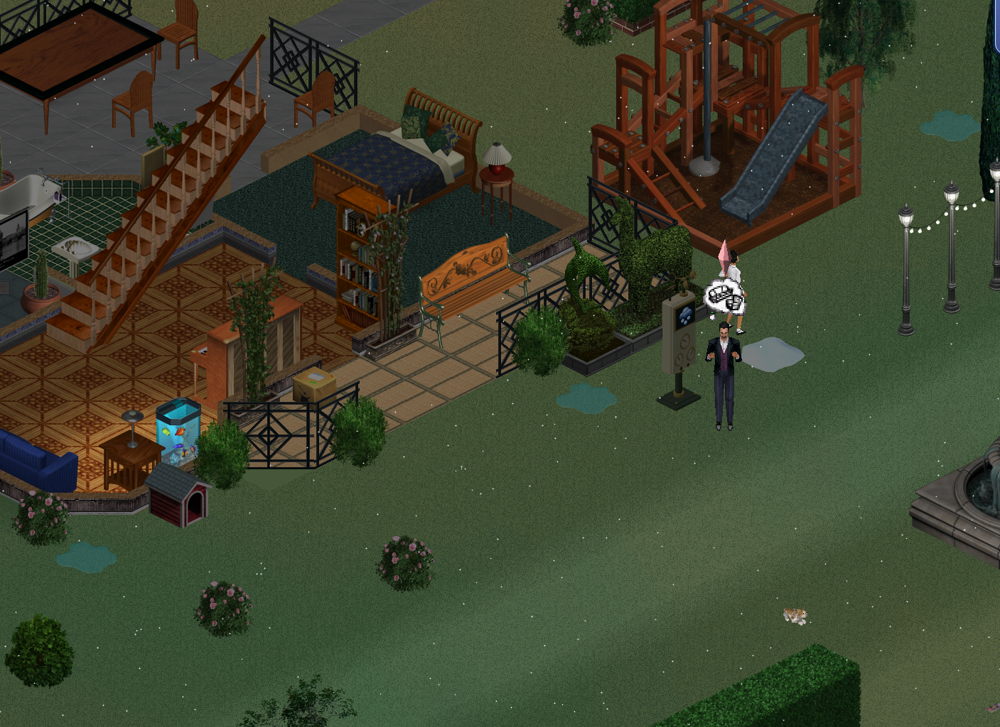

# 模擬市民 四季

**首個公開測試版 · 1.0.0-beta.1**

<!-- quick-links -->
  
<!-- /quick-links -->

[English](../README.md) · [Polski](README.pl-PL.md) · [Dansk](README.da-DK.md) · [Deutsch](README.de-DE.md) · [Español](README.es-ES.md) · [Suomi](README.fi-FI.md) · [Français](README.fr-FR.md) · [Italiano](README.it-IT.md) · [日本語](README.ja-JP.md) · [한국어](README.ko-KR.md) · [Norsk bokmål](README.nb-NO.md) · [Nederlands](README.nl-NL.md) · [Português (Brasil)](README.pt-BR.md) · [Svenska](README.sv-SE.md) · [ไทย](README.th-TH.md) · [简体中文](README.zh-CN.md) · **繁體中文**

這款玩家製作的模組為 The Sims Legacy Collection 加入春夏秋冬，以及每戶獨立的每週行事曆。到了週末，孩子不用上學，上班的模擬市民也能放假。秋天樹葉變色，冬天庭院積雪。模擬市民可以看電視了解明天的天氣、踩水窪、堆雪人，也能學會兩種改變天氣的咒語。

*屋頂和植物覆蓋著積雪的冬日地段*

[遊戲截圖](#gallery) · [完整圖集（ZIP，9 張圖片）](https://github.com/TS1-Mod-Studio/The-Sims-1-Four-Seasons/releases/download/v1.0.0-beta.1/The-Sims-1-Four-Seasons-Screenshots.zip)

## 用地裡的四季

### 一週、四季與明日天氣

- 日曆從星期一排到星期日。每逢週六、週日，孩子不用上學，有工作的模擬市民也放假。校車和上班共乘車不會來接人，週末也不算曠職。跨夜班同樣適用。
- 每個家庭地段都有自己的日曆。春、夏、秋、冬預設各持續 7 個模擬日，也可以調成每季 14 或 28 天。按 **Ctrl+Alt+R** 開啟日曆，即可調整季節、該季的第幾天、星期幾及時間。儲存家庭時，日曆和天氣也會一併儲存。
- 可收合的預報面板會顯示今天是星期幾、目前季節、氣溫及天氣。明天的預報分為夜間、上午、下午、傍晚四個時段。開啟自動天氣後，模擬市民也能用支援的電視收看氣象預報。
- 前往一般社區地段時，天氣和季節進度會隨家庭一起移動。度假島各區有自己的氣候，山區是冬天，森林是春天，海灘是夏天。度假期間，家中的日曆會停留在出發時的日期。

### 庭院與屋裡的天氣變化

- 雨、雷雨、冰雹、雪、暴風雪和霧都可能自然出現，雨後也可能起霧。風會把雨絲和秋葉吹過地段。閃電過後會聽見雷聲，雨水會沿著屋頂流下。一般降雨還能撲滅戶外火勢，包括雷擊引起的火災。
- 雨水會澆灌露天植物，強烈的冰雹則可能損傷戶外觀賞植物。螢火蟲會在夜裡的花叢與灌木附近出現，夏夜尤其常見。秋天樹葉會變色。冬天的積雪會覆蓋地面、屋頂、道路、圍欄、植物、戶外物件和墓碑，天氣回暖後逐漸融化。
- 模擬市民、貓和狗在戶外都會淋濕，有遮蔽的地方乾得比較快。他們可能會主動避雨，或在身上變乾時留下可以拖乾的小水窪。模擬市民淋濕太久可能生病、咳嗽和打噴嚏，在乾燥處休養就能康復。孩子有時會自己在戶外踩水。大人和孩子也能依玩家指示去踩水，增加娛樂值。
- 氣溫低於冰點時，模擬市民會在戶外轉個圈換上冬裝，回到室內再換回原本的衣服。他們會穿自己買的冬裝。如果還沒買，模組會隨機挑一套，以後出門也穿這套。花 **§1** 購買堆雪人的位置並放在戶外。當地面積雪覆蓋率達到 **60%**，就可以在該處堆雪人，社區和度假地段也適用。植物沒有積雪時，這裡會長出野花。植物被積雪覆蓋時，野花會變成雪堆。

### 魔法書裡的兩個新咒語

持有魔杖的成年模擬市民可以在魔杖充能器調製這兩個配方。每種材料各用一份，每次調製可施法 **3 次**。在充能器上選擇施法，施法成功後，魔法天氣會持續 **3 個模擬小時**。地段裡沒有氣象站也能施法。

- **魅惑之霧**需要妖精塵、龍之淚和毒蕈。花園地精和稻草人可能活起來，草坪上的紅鶴可能變成舞者，西洋棋和西洋跳棋可能自己下起棋來，冰箱門也會自行開關。地上可能長出可採集的毒蕈。**22:00 至 06:00**，某些墓碑附近的鬼魂會更活躍。起霧期間，使用支援的物件可讓精力、娛樂、衛生、如廁和飢餓需求的恢復速度提高 **50%**，透過技能物件學習的速度則變成 **2 倍**。你可以調整魔法事件的頻率，並分別開關各項加成。
- **魅惑之雨**需要妖精塵、龍之淚和五彩小丑玩偶。彩色雨滴會留下帶有動畫的彩虹水窪。雨水會澆灌露天的活植物、改善長勢，還可能讓種下的作物成熟。空曠草地上最多能長出 **7 顆**《Makin’ Magic》原有的能力水晶。雨停後水晶仍會留在地段上，成熟後模擬市民就能向它們學習特殊能力。
- 魔法天氣也會自然發生。在魔法城比較容易遇到魅惑之霧，尤其是夜晚。除了冬季以外，當地也較常下魅惑之雨。

### 氣象站、天氣設定與音樂

- **取得氣象站。** 家中同一位模擬市民的**邏輯與機械技能都達到 10 點**後，氣象站會出現在住宅用地內的戶外空地上。這項技能獎勵每戶限領一次，也是取得氣象站的唯一途徑。領取之前，天氣就會自動變化。
- **操作氣象站。** 技能尚未達標的模擬市民可以在氣象站查看操作條件。**邏輯至少 7 點、機械至少 6 點**的模擬市民可以指定季節和星期幾，也能啟動或結束降雨、雷雨、冰雹、降雪、暴風雪、霧、魔法雨和魔法霧。每種天氣都有三段強度可選。
- 天氣面板提供獨立開關，可以調整淋濕、對雨的反應、生病、換冬裝、躲避冰雹、雨水形成的水窪、身上變乾時留下的水窪、踩水、堆雪人、雨水滅火，以及雨後起霧。也可以調整特效、音量和動畫效能。天氣會配合遊戲的暫停、速度、縮放與鏡頭移動。
- 本模組附有多種語言的載入畫面，以及原創載入音樂《Pocztówka z doliny》。

## 下載與安裝

請先在 64 位元 Windows 上安裝 The Sims Legacy Collection 完整版（遊戲版本 **1.10.0** 或 **1.10.7**）和 [Microsoft .NET Desktop Runtime 10 (x64)](https://dotnet.microsoft.com/download/dotnet/10.0)。請預留數 GB 的磁碟空間，並另外準備足夠空間來備份存檔。

1. 前往 GitHub 的 [Releases](https://github.com/TS1-Mod-Studio/The-Sims-1-Four-Seasons/releases/tag/v1.0.0-beta.1) 頁面，開啟 **1.0.0-beta.1**，從 **Assets** 下載 `The-Sims-1-Four-Seasons-1.0.0-beta.1.zip`。
2. 儲存遊戲，結束遊戲和天氣程式。將整個 ZIP 檔解壓縮到新的資料夾，讓 `data` 資料夾和 `Setup.exe` 放在同一層。
3. 執行 `Setup.exe`，選取包含 `sims.exe` 的遊戲資料夾。先按 **檢查相容性** 檢查檔案，再按 **安裝**。安裝程式會驗證並備份檔案，接著修補電腦上已安裝的遊戲資源。若必要檔案的內容與預期不符，安裝程序會停止。
4. 等候安裝完成的訊息。往後請使用桌面的 **The Sims Cztery Pory Roku** 捷徑，或執行程式安裝資料夾中的 `Launch-weather.cmd` 來開啟遊戲。天氣服務和讀取存檔時還原天氣的功能會一併啟動。

請透過安裝程式修補遊戲檔案。程式會在每次修補前後比對檔案的雜湊值，並保留原本的 `sims.exe`。選用物品只有在電腦上已經安裝支援的版本時才會套用修補。

## 使用天氣設定程式

透過桌面捷徑啟動遊戲時，天氣程式與負責將用地天氣、日曆和存檔同步的服務也會一併啟動。遊戲中按 `Ctrl+Alt+R`，或在 Windows 通知區域的天氣圖示上按兩下，即可開啟設定。

降雨、雷雨、降雪和霧各有專屬分頁，可以調整降水強度、霧的濃度和音效音量等項目。風、雲量和螢火蟲也可以分別設定。在日曆中可以更改星期幾和季節，在遊戲設定中則可以個別開關天氣對模擬市民行為和健康的影響。物件選單和程式預設採用遊戲語言。在程式中另選顯示語言後，下次啟動時就會套用。

## 備份、更新與解除安裝

安裝程式會備份將要修改的檔案、遊戲存檔和天氣資料。請將 `%LOCALAPPDATA%\TS1CzteryPoryRoku` 下程式安裝資料夾裡的 `backups` 資料夾和 `install-state.json` 檔案保存在一起。部分用地天氣資料存放在 `%LOCALAPPDATA%\TS1RainOverlay`。手動還原存檔時，請先結束遊戲。遊戲與天氣程式請保留在原本的安裝位置。

存檔備份包含 Windows 的已儲存遊戲資料夾中的 `Electronic Arts\The Sims 25`，以及遊戲目錄裡現有的 `UserData`, `UserData2` 等資料夾。每次備份會建立專屬的資料夾。`save-backup.json` 記錄了原始路徑與檢查碼，方便你在手動還原時找到對應的檔案。

更新時，請關閉遊戲和天氣程式，將新的 ZIP 檔解壓縮到另一個資料夾，接著在安裝程式中選取原來的遊戲資料夾。要移除模組，請先關閉兩者，再開啟先前保留的 `Setup.exe` 並選擇 **選項 → 解除安裝**。程式會還原原有的遊戲檔案，並保留存檔與備份。如果之後還想使用模組的物品，請先備份用地，再移除模組繼續遊玩。

若安裝中途意外中斷，請選擇 **選項 → 復原變更**。還原時若收到檔案已變更的訊息，請保留備份和完整錯誤訊息。若 Windows 拒絕寫入，請在同一個 Windows 帳戶下以系統管理員身分執行 `Setup.exe`。

<!-- gallery -->

## 遊戲截圖

**天氣設定 · 降雨**

| 秋雨 | 籠罩用地的霧 |
| --- | --- |
|  |  |

| 花園裡的冰雹 | 魔法迷霧 |
| --- | --- |
|  |  |

| 魔法雨和水窪 | 英文版載入畫面 |
| --- | --- |
|  |  |

**明日天氣預報**

<!-- /gallery -->

## 測試進度與問題回報

上述兩個遊戲版本都已進行過安裝程式檢查。其他電腦、較低規格的硬體，以及全部 17 種語言的完整遊玩測試仍在進行中。若開啟 NVIDIA 遊戲內覆蓋功能後天氣畫面變慢，可以先關閉該功能再試一次。

請在 GitHub 的 [Issues](https://github.com/TS1-Mod-Studio/The-Sims-1-Four-Seasons/issues) 提供遊戲版本、模組版本、語言和重現問題的步驟。回報畫面問題時，請附上截圖，並註明當時的天氣、縮放程度、鏡頭方向、樓層和牆面顯示模式。若安裝發生問題，請附上完整錯誤訊息。公開紀錄檔前，記得檢查其中是否有含個人資訊的檔案路徑。

<!-- fan-project -->
---

這是玩家製作的非官方模組，與 Electronic Arts 或 Maxis 無關，也未獲兩家公司的認可或贊助。The Sims 是 Electronic Arts 的商標。
